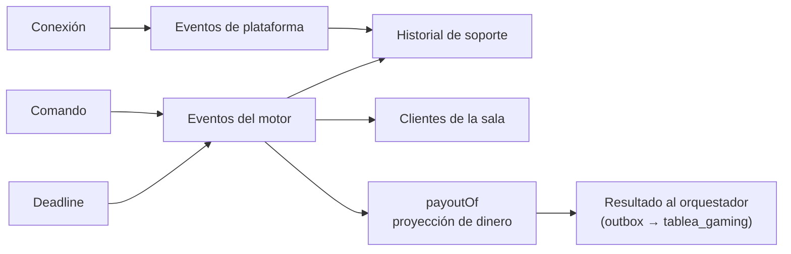

# API HTTP y mensajes

El juego usa WebSocket/Colyseus para la partida y HTTP para configuración, operación y la API del
orquestador. Dominó no tiene catálogo de modos: los modos son del orquestador, que los lee y los edita,
y manda el modo entero en cada mesa casual (`gameMode`, en «API del orquestador»). No hay Swagger: los mensajes de sala no son HTTP y los contratos se mantienen
tipados en el código.

## Salas Colyseus

| Sala | Quién entra | Estado principal |
|---|---|---|
| `domino` | Participante reservado con JWT válido | Partida, ronda, jugadores, tablero, pozo, turnos y deadlines |

Es la única sala. No hay lobby ni emparejamiento en este servidor: los hace el orquestador, que abre
cada mesa por `POST /internal/matches` y le entrega a cada jugador su reserva de asiento. El jugador
se conecta con esa reserva y su JWT; el `sub` del token es el `userId` con el que el orquestador lo
sentó, normalizado con `trim()`.

## Mensajes de la sala `domino`

| Tipo | Payload del cliente | Efecto |
|---|---|---|
| `REVEAL_TILES` | `{}` | Confirma que el jugador levantó su mano durante `DEALING` |
| `PLAY_TILE` | `{ left, right, side }` | Coloca una ficha legal en `LEFT` o `RIGHT` |
| `DRAW_TILE` | `{}` | Toma del pozo cuando no tiene jugada |
| `PASS` | `{}` | Pasa cuando no puede jugar ni cargar |
| `ABANDON` | `{}` | Abandono voluntario |
| `PROPOSE_BET_MULTIPLIER` | `{ level }` | Congela el turno y abre la negociación |
| `RESPOND_BET_MULTIPLIER` | `{ accept }` | Acepta o rechaza la propuesta vigente |
| `SEND_REACTION` | `{ reactionId }` | Manda un gesto a la mesa (ver «Reacciones») |

El cliente no envía `playerId`: el handler lo toma del asiento autenticado. Cada payload pasa por un
decoder estricto antes de alcanzar el comando.

### Reacciones

`SEND_REACTION` `{ reactionId: string }` (de 1 a 64 caracteres; un campo de más, como el
`targetPlayerId` del front viejo, se ignora) pone un gesto del catálogo en la mesa: la sala lo
difunde a **todos**, el que lo mandó incluido, como `REACTION_SENT`. El cliente manda el id y el
contenido lo pone el servidor, así que no es un chat.

- `fromPlayerId` es el asiento que lo mandó (`seat-1`, `seat-2`…), el mismo `playerId` de
  `state.players[]`: el cliente lo ubica con `players.find((p) => p.playerId === fromPlayerId)`.
- Puede mandar cualquier jugador sentado en la sala, en cualquier fase mientras la sala esté
  abierta: el reparto, la mano, entre manos y la pantalla del resultado.
- **Límite:** 3 gestos cada 2 s por jugador, ventana deslizante, por mesa.
- **Los rechazos son silenciosos:** un id que no está en el catálogo o un gesto por encima del límite
  no se difunden ni devuelven nada (quedan en el log de debug). Sólo el payload malformado (sin
  `reactionId`, o de otro tipo) contesta `illegal` con `MALFORMED`.
- No toca la partida: no cambia el estado, no produce `events` y no entra en el historial ni en el
  registro de la partida.

La lista de gestos la sirve `GET /reactions` (ver «HTTP público»).

## Mensajes del servidor

Lo que la sala `domino` le manda al cliente, además del estado sincronizado.

| Tipo | A quién | Payload | Cuándo |
|---|---|---|---|
| `config` | Al que entra o vuelve | La config pública de la mesa más `serverNow` (forma abajo) | Al final de cada entrada (`onJoin`) y de cada reconexión (`onReconnect`) |
| `events` | Toda la mesa | Lista de eventos del motor y de plataforma (`ROUND_STARTED`, `MATCH_RESOLVED`, `PLAYER_RECONNECTED`…) | Cada vez que la partida produce hechos |
| `illegal` | El que mandó el mensaje | `{ code, detail? }`: `code` es el de la regla violada, `MALFORMED` (con `detail`) o `UNKNOWN_COMMAND` | Su mensaje no prosperó; el estado no cambió |
| `matchCancelled` | Toda la mesa | `{ reason: "CHARGE_REJECTED" \| "SEATING_TIMEOUT" }` | `CHARGE_REJECTED`: el orquestador no cobró la entrada. `SEATING_TIMEOUT`: venció el plazo de ocupación sin que todos entraran (sale abortada `NEVER_STARTED`, sin cobro). En los dos la sala se cierra sin arrancar, con 4000, justo después |
| `REACTION_SENT` | Toda la mesa, el que lo mandó incluido | `{ fromPlayerId, reaction: { id, type, content } }` | Un jugador mandó un gesto válido dentro del límite (`SEND_REACTION`) |

**`config`** trae lo mismo que `GET /config/:roomId`, sin pedirlo por HTTP:

```ts
{
  mode: "CASUAL" | "TOURNAMENT";
  tournamentId?: string;        // solo en una mesa de torneo
  matchId: string;
  gameModeId: string;           // en una de torneo, "tournament:<tournamentId>"
  seats: string[];              // ids opacos: "seat-1", "seat-2"…
  pointsToWin: number;
  entryFee: Money;              // { uc: "125.0000" } (ver «Montos», abajo)
  prize: Money;                 // { uc: "250.0000" }
  // `extra` y `additionalPoints` NO son plata: pesos de los puntos del ranking. Siguen siendo números.
  betLevels: { level: number; extra: number; additionalPoints: number }[]; // [] = no ofrece aumentar
  isFreeRoom: boolean;
  enableBots: boolean;
  timeouts: { turnMs: number; extraTimeMs: number; dealingMs: number; betResponseMs: number };
  // Opcional: lo que la mesa cuesta y paga EN LA MONEDA de cada asiento, por su id opaco. Sólo los
  // asientos que trajeron `price` en el pedido; ausente si ninguno (mesa gratis, orquestador viejo).
  seatPrices?: {
    [playerId: string]: {
      rate: string;             // la tasa que billing congeló, como texto
      entry: Money;             // lo que costó sentarse: { ves: "25000.00", uc: "125.0000" }
      prize: Money;             // lo que cobra cada ganador sin aumento
      levels: { level: number; entry: Money; prize: Money }[]; // subir a ese nivel cobra `entry`
    };
  };
  serverNow: number;            // epoch ms del servidor al mandarlo, para el desfase de reloj
}
```

El front toma `seatPrices[<su playerId>]` (el `playerId` de su asiento en el estado) y pinta entrada,
premio y cada aumento en la moneda del jugador: la llave que no es `uc` (la moneda ya no viaja en un
`currency` aparte). Sin entrada para su asiento, sigue en UC. Los montos en su moneda son los que cotizó
billing: no se convierten ni se redondean, y se rellenan con los decimales de la moneda solo si el
orquestador los mandó (`price.decimals`). El `uc` de cada uno es el de la mesa: `entryFee`, `prize`, y
para el nivel N `entryFee × (N − 1)` y `prize × N`. `entryFee` y `prize` de arriba son lo que billing
cobra.

Nunca lleva el `seed`, ni identidad, ni el `rateId` de la mesa; moneda y tasa salen sólo dentro de
`seatPrices` (el precio del rival es visible: no es secreto). Lo que la sala manda en `onJoin` Colyseus lo
encola hasta que el cliente confirma la entrada, así que llega apenas resuelve el `join` y antes de
cualquier `events` posterior. El handler se registra **justo después del `join`, sin un `await` en
el medio** (por ejemplo, no después de `waitForInitialState()`): si no, el mensaje llega antes que el
handler. Un cliente que no lo escucha solo ve un aviso del SDK.

## Estado visible

`StateView` filtra el árbol por cliente:

- Cada jugador ve sus fichas y sólo el conteo de las fichas rivales.
- Nadie ve el contenido del pozo; sí ve cuántas quedan.
- `displayName`, `username` y `profilePicture` son presentación sincronizada.
- `userId` (el `sub` del token) viaja en cada asiento: así el cliente reconoce el suyo con
  `players.find((p) => p.userId === sub)`, también antes de revelar las fichas. Es el último campo de
  `PlayerState`.
- La moneda no es del estado: vive en el `seat` de la config del servidor y no viaja por wire.
- La oferta de aumento en curso (`currentRound.betOffer`) lleva `additionalEntryFee`, lo que le cuesta
  aceptar a cada asiento, como un mapa en la convención de montos con solo `uc`
  (`MapSchema<string>`: `{ uc: "125.0000" }`). Es de toda la mesa: lo mismo en la moneda de cada uno
  está en `seatPrices[seat].levels`.
- Las fichas colocadas, el turno, puntajes, fases y deadlines son públicos.

## HTTP público

| Método y ruta | Uso |
|---|---|
| `GET /health` | Liveness del proceso; nunca consulta dependencias |
| `GET /ready` | Readiness; responde `503` y lista dependencias faltantes |
| `GET /config/:roomId` | Config pública de una mesa (la misma forma que el mensaje `config`: `betLevels: [{ level, extra, additionalPoints }]`, vacío si no ofrece aumentar, `isFreeRoom`, `enableBots`, `timeouts` y, opcional, `seatPrices` por `seat-N`) y `serverNow`; nunca devuelve el seed. Respaldo del mensaje `config` |
| `GET /matches/:roomId` | La misma config pública, con `Authorization: Bearer <JWT>` |
| `GET /me/matches?page=&limit=` | Historial del dueño del token (`Authorization: Bearer <JWT>`): sus partidas terminadas, la más nueva primero, desde su asiento (`id` es el `matchId`, `roomId` la sala de Colyseus; `result`, `score`, `playedAt`; y `bet` y `prize` en la convención de montos: `{ ves: "400.00", uc: "4.0000" }` si su asiento se sentó con `price` —la moneda congelada al cerrar—, y `{ uc }` si no). Página de 1 a 50, 10 por defecto |
| `GET /reactions` | La lista de gestos de `SEND_REACTION`, sin credencial (ver abajo) |

**`GET /reactions`** responde con `Cache-Control: public, max-age=300` la lista fija del dominó (vive
en el código, `src/features/reactions/static-catalog.ts`, y es la misma para todos los proveedores):
un solo paquete, `global`, con 24 emojis en el orden en que se dibujan.

```json
[{ "pack": "global", "items": [{ "id": "grin", "type": "emoji", "content": "😀" }, …] }]
```

Los ids, en orden: `grin` 😀, `joy` 😂, `cool` 😎, `heart-eyes` 😍, `angry` 😡, `sob` 😭,
`thumbs-up` 👍, `thumbs-down` 👎, `pray` 🙏, `muscle` 💪, `victory` ✌️, `fire` 🔥, `zzz` 💤,
`thinking` 🤔, `sleeping` 😴, `mind-blown` 🤯, `scream` 😱, `huffing` 😤, `devil` 😈, `skull` 💀,
`trophy` 🏆, `dollar` 💵, `money-bag` 💰, `money-mouth` 🤑.

Todas las respuestas HTTP exponen el header `Date`, que permite recalcular el desfase del reloj del
cliente. `/config/:roomId` agrega `serverNow` para la medición inicial.

## HTTP interno

Estas rutas requieren una de dos credenciales:

- el header `x-internal-api-key` con la llave de administración (scripts y soporte). Vale como un
  admin de **Tablea Gaming** con rol `admin`;
- `Authorization: Bearer <token>` con el token de admin que billing-auth emite cuando un admin inicia
  sesión (`POST /v1/auth/login` de billing-auth): ES256, audiencia `tablea-gaming-admin` y
  `typ: admin`. Sus claims `prv` (el proveedor del admin; `null` es Tablea Gaming) y `role` (`admin` o
  `support`) dicen qué abre, y son **obligatorias**: un token sin `prv` (texto o `null` explícito) o
  sin `role` es `401`, igual que un rol desconocido o un `prv` vacío o que no es texto.

Si `ADMIN_API_KEY` no existe, no se registran y responden 404: fallan cerradas. Los errores de todas
salen `{ code, detail? }` (ver [«Errores»](#errores)).

**Quién entra.** El default es el cerrado: una ruta es de Tablea Gaming y de escritura salvo que diga
lo contrario. `support` sólo lee. Un admin de **proveedor** sólo entra a las rutas que acotan su
ámbito —el listado y el detalle de partidas—; en todas las demás recibe
`403 { code: "FORBIDDEN" }`.

| Rutas | Tablea Gaming `admin` (y la llave) | Tablea Gaming `support` | Proveedor `admin` | Proveedor `support` |
|---|---|---|---|---|
| `GET /internal/matches`, `GET /internal/matches/:matchId` | todo (o el proveedor de `?providerId=`) | ídem | sólo las partidas con algún asiento suyo | ídem |
| `GET /internal/matches/:matchId/history`, `GET /internal/players/:userId/matches`, `/game-data/:roomId` | sí | sí | 403 | 403 |
| `GET /internal/settings…` | sí | sí | 403 | 403 |
| `PATCH`/`DELETE /internal/settings/:section` | sí | 403 | 403 | 403 |

| Método y ruta | Uso |
|---|---|
| `GET /internal/matches/:matchId/history` | Historial ordenado por `seq` para soporte (lee `timeline` y, en los documentos viejos, `entries`) |
| `GET /internal/matches?pageSize=&after=&from=&to=&matchId=&roomId=&id=&userId=&matchEndReason=&status=&tournamentId=&providerId=` | Listado de partidas para el panel, la más nueva primero, filtrado y paginado por cursor; un proveedor ve sólo las suyas (ver «El registro de cada partida») |
| `GET /internal/matches/:matchId` | El documento guardado de una partida, entero; a un proveedor, sólo si algún asiento es suyo |
| `GET /game-data/:roomId` | El documento guardado, pelado, para el detalle de movimientos del backend principal |
| `GET /internal/players/:userId/matches?page=&limit=` | Historial de un jugador para el panel: la misma página que `GET /me/matches` le devuelve a ese `userId` (mismos parámetros y límites), dentro de `{ status: "success", data }`. El `userId` sigue la regla de texto del filtro del listado |
| `GET /internal/settings` | Las secciones de config en caliente (`match`; en local y dev también `deal` y `starting-score`): en vigor, overrides y editables |
| `GET /internal/settings/:section` | Una sección |
| `PATCH /internal/settings/:section` | Parche de uno o más campos; cotas estrictas, clave desconocida = 400 |
| `DELETE /internal/settings/:section` | Vuelve la sección a los defaults del entorno |

### El registro de cada partida

Cada partida deja **un documento** en `match_history`, con la forma v2.1 de truco (`version: 2.1`). Se
abre al primer reparto (`status: "started"`, con `roomId`, `table`, `matchConfig` —seed y parejas
incluidos—, `seats` y `matchStartedAt`), se alimenta durante la partida (`timeline`, la secuencia de
actos y hechos; `rounds`, lo que las reglas concluyeron de cada mano) y se cierra al terminar
(`status: "finished" | "aborted"`, `matchEndedAt`, `matchDurationInMs`, `matchEndReason`, ganadores,
`players` con su salida y su plata, `rateId`, `betMultiplier` y `rankingMultiplier`). Un asiento que se
sentó con `price` lo guarda en `seats[]` y `players[]`, y su plata suma `chargedInPlayerCurrency` y
`prizePaidInPlayerCurrency` (texto decimal, elegidos del precio con la regla de UC). Así queda **en
Mongo**; las cuatro rutas que lo leen lo devuelven con los montos en la convención (ver «El registro en
la convención de montos», abajo). Un asiento cuyo
participante trajo `providerId` lo guarda también en `seats[]` y `players[]`. Una mesa que nunca
arrancó nace en el cierre. Los instantes son fechas (ISO en el JSON); las duraciones, números. Los
documentos de antes de la v2.1 (`{ matchId, entries, createdAt, updatedAt }`) se siguen leyendo en las
cuatro rutas.

**`GET /internal/matches`** — el listado del panel, la más nueva primero (`createdAt` descendente y
`_id` de desempate), paginado **por cursor**. Todos los parámetros son opcionales y los filtros se
combinan con AND:

| Parámetro | Qué es | Inválido (400 `MALFORMED`) |
|---|---|---|
| `pageSize` | Filas por página, entero de 1 a 100; default 20 | fuera de rango, no entero |
| `after` | El `nextCursor` de la página anterior, tal cual | cualquier cosa que no sea un cursor emitido por esta ruta |
| `from`, `to` | Instantes ISO 8601 **con hora y zona** (`2026-10-01T00:00:00.000Z`, `…-04:00`): `createdAt >= from` y `createdAt < to` | una fecha sin hora, un instante imposible, `from` posterior a `to` |
| `matchId` | Igual a | vacío, más de 128 caracteres, caracteres de control |
| `roomId` | Igual a | ídem |
| `id` | El `_id` del documento: 24 hexadecimales | otra cosa |
| `userId` | Un jugador: igual al `userId` de **alguno** de los asientos (`seats[].userId`), en mesas de dos o de cuatro. Una partida en la que el mismo usuario ocupa dos asientos sale una vez. Los documentos de antes de la v2.1 no tienen asientos y no coinciden nunca | ídem `matchId`, o repetido |
| `matchEndReason` | El motivo del cierre, exacto: `SCORE`, `ABANDONMENT`, `NEVER_STARTED`, `TILES_NOT_SEEN`, `NEVER_PLAYED`, `INTERRUPTED` o `CHARGE_REJECTED`. Una partida todavía abierta no tiene motivo y no coincide con ninguno | otro valor (en minúsculas incluido), vacío o repetido |
| `status` | El estado del documento, exacto: `started` (abierta), `finished` o `aborted`. Sin él salen todos los estados. Los documentos de antes de la v2.1 no tienen estado y no coinciden nunca | otro valor (en mayúsculas incluido), vacío o repetido |
| `tournamentId` | Un torneo: igual al `table.tournamentId` de la mesa. Una casual y los documentos viejos no lo llevan y no coinciden nunca | ídem `matchId`, o repetido |
| `providerId` | Un proveedor: igual al `providerId` de **alguno** de los asientos (`seats[].providerId`). Una casual cruzada sale para los dos proveedores, y una vez aunque el proveedor ocupe dos asientos. Una partida grabada sin el campo no coincide nunca. **Un admin de proveedor siempre lo tiene puesto con el suyo**: nombrar el suyo es lo mismo, y nombrar otro responde `404 { code: "UNKNOWN_PROVIDER" }` | ídem `matchId`, o repetido |

Un parámetro que no está en la tabla se ignora (`page` incluido: ya no existe). `from` igual a `to` es
un rango vacío, no un error.

```json
{
  "status": "success",
  "data": {
    "items": [
      {
        "_id": "6717a2f0c3bf3e710572f941",
        "matchId": "orq-8f2c",
        "roomId": "ZYIVoz6TQ",
        "game": "domino",
        "status": "finished",
        "table": { "gameModeId": "…", "name": "Clásica 1v1", "entryFee": { "uc": "10.0000" }, "prize": { "uc": "18.0000" }, "isFree": false },
        "createdAt": "2026-10-22T14:00:00.000Z",
        "updatedAt": "2026-10-22T14:09:31.000Z",
        "matchStartedAt": "2026-10-22T14:00:03.000Z",
        "matchEndedAt": "2026-10-22T14:09:00.000Z",
        "matchEndReason": "SCORE",
        "winnerIds": ["seat-1"]
      }
    ],
    "pageSize": 20,
    "nextCursor": "eyJ0IjoxNzkyNjc3NjAwMDAwLCJpZCI6IjY3MTdhMmYwYzNiZjNlNzEwNTcyZjk0MSJ9",
    "total": 1234,
    "totalExact": true
  }
}
```

- **`nextCursor`** es opaco (base64url de `{ t, id }`: el `createdAt` en epoch ms y el `_id` de la última
  fila) y es `null` en la última página. La página siguiente se pide con `after=<nextCursor>` **y los
  mismos filtros**; empieza estrictamente después de esa fila, así que un empate en el mismo
  milisegundo no repite ni pierde filas, y una página honda cuesta lo mismo que la primera.
- **`total`** se cuenta barato: sin filtros es el estimado de la colección (`totalExact: false`); con
  algún filtro se cuenta hasta 10 000 (`totalExact: true`, o `total: 10000` y `totalExact: false` si
  hay más); con `after` no se cuenta (`total: null`, `totalExact: false`).
- **Plazo**: cada consulta tiene 5 s. Si la base no contesta a tiempo:
  `503 { code: "MATCH_LIST_TIMEOUT", detail: "La búsqueda tardó demasiado; acota el rango de fechas" }`.

Cada fila es un resumen: sin `timeline` ni `rounds`. Un documento viejo aparece con lo que tiene
(`_id`, `matchId`, `game`, `createdAt`, `updatedAt`) y sale en todo listado que no filtre por sala.

**`GET /internal/matches/:matchId`** — `200 { status: "success", data: <documento> }`, con el `_id`
como texto y `rounds`/`timeline` al final; `404 { code: "MATCH_NOT_FOUND" }`. A un admin de proveedor,
el mismo `404` si ningún asiento lleva su `providerId` (una partida grabada sin el campo sólo la ve
Tablea Gaming).

⚠ En una casual cruzada los dos proveedores ven el documento **entero**, el asiento del rival incluido
(su `userId`, su nombre y su mano en la timeline): es la partida que jugó su jugador.

**`GET /game-data/:roomId`** — el contrato del backend principal, igual que en truco: `200` con el
documento pelado (sin envelope y sin `_id`) y `404 { code: "MATCH_NOT_FOUND" }`. Busca por `roomId` y,
si no, por `matchId` (los documentos viejos no guardaban la sala).

Las tres van con la llave o el token de admin; sin credencial, `401 { code: "UNAUTHORIZED" }` antes de
mirar la forma. El `POST /internal/matches` del orquestador es otra ruta, con su llave.

**El registro en la convención de montos.** Mongo guarda los montos como siempre, y el listado, el
detalle, `/game-data` y `GET /internal/matches/:matchId/history` los traducen al salir
(`network/record-view.ts`). Lo que no reconocen lo dejan como está: un documento de antes de la v2.1
sale igual, y un campo que falta no se inventa.

| En Mongo | En la respuesta |
|---|---|
| `table.entryFeeInUC: 10`, `table.prizeInUC: 18` | `table.entryFee: { "uc": "10.0000" }`, `table.prize: { "uc": "18.0000" }` |
| `seats[].price`, `players[].price`: `{ currency, rate, entry, prize, levels, decimals? }` con textos | `{ rate, entry, prize, levels }` con cada monto `{ "ves": "…", "uc": "…" }` (el `uc` de la mesa, como en `seatPrices`) |
| `players[].chargedInUC: 20` + `chargedInPlayerCurrency: "4000.00"` | `players[].charged: { "ves": "4000.00", "uc": "20.0000" }` (`{ uc }` solo si el asiento no tiene precio) |
| `players[].prizePaidInUC` + `prizePaidInPlayerCurrency` | `players[].prizePaid: { "ves": "…", "uc": "…" }` |
| `betMultiplier.resultingEntryFeeInUC`, `resultingPrizeInUC` | `betMultiplier.resultingEntryFee`, `resultingPrize`: `{ uc }` |
| `timeline[]` `MULTIPLIER_AGREED`: `payload.additionalEntryFee: 125` | `payload.additionalEntryFee: { "uc": "125.0000" }` |

`seats[].currency` (la moneda del jugador) se queda: es del asiento, no de un monto. `rankingMultiplier`
y `betMultiplier.offeredValues`/`finalValue` no son plata.

**Config en caliente.** Una edición llega a las mesas que nacen DESPUÉS; una mesa ya abierta conserva
los plazos con los que nació. El proceso que atiende el `PATCH` se refresca en el acto y el resto
del clúster converge en 5 s. Fuera de lo editable queda `tilesPerPlayer` (regla de juego): se rechaza
con 400 en vez de aceptarse e ignorarse.

### API del orquestador

Cinco rutas que sólo usa el orquestador de Tablea Gaming; las de las mesas son la única puerta
de entrada a una partida. Van con `x-internal-api-key` igual a
`ORCHESTRATOR_API_KEY` (`ADMIN_API_KEY` no las abre); sin esa variable no se registran y responden 404.
Un `401 { code: "UNAUTHORIZED" }` es una llave ausente o equivocada, y se decide ANTES de mirar el
cuerpo.

**`POST /internal/matches`** abre una mesa. Cuerpo (`CreateMatchRequest`, estricto: una clave de más
es 400), discriminado por `mode`:

- **`"CASUAL"`**: `matchId`, `gameModeId` (el uuid del modo en el catálogo del orquestador; dominó no lo
  resuelve, nombra la mesa), `gameMode` (**obligatorio**: el modo en línea, abajo), `participants` (2 a
  4, par; cada uno `userId`, `displayName`, `currency` y, opcionales, `username`, `profilePicture`,
  `price` y `providerId`), `seed`, `teamAssignment` (`SHUFFLED` o `SEAT_ORDER`), `rateId` (opaco: el
  `_id` de Mongo de la tasa de Betaso) y `betLevels` opcional (abajo).
- **`"TOURNAMENT"`**: `matchId`, `tournamentId`, `participants` y `teamAssignment` como la casual,
  `seed` y `rules: { pointsToWin }` (entero positivo seguro; el tope lo decide `apps/tournaments`, no
  el dominó, cuyo motor solo usa `pointsToWin` como meta). **Sin** `gameModeId`, `gameMode`, `rateId` ni
  `betLevels`: traer alguno es 400. Es gratis (`isFreeRoom`, entrada y premio 0),
  sin aumentos, sin bots y sin revancha, con la ventana de reparto y los plazos de cualquier mesa
  (la config global, con sus ediciones en caliente). Con la mesa completa **arranca sin pedir cobro**
  al orquestador. En el snapshot, el registro y el censo su `gameModeId` es
  `"tournament:<tournamentId>"` y su `rateId` es `"none"`.

| Estado | Cuerpo | Cuándo |
|---|---|---|
| `201` | `{ status, data: { roomId, seats: [{ userId, reservation }] } }` | La sala nació; cada jugador consume su `reservation` |
| `400` | `{ code: "MALFORMED", detail }` | El cuerpo no cumple la forma |
| `401` | `{ code: "UNAUTHORIZED" }` | Llave ausente o equivocada |
| `400` | `{ code: "MALFORMED", detail }` | También: una casual sin `gameMode`, o con un `gameMode` fuera de su forma |
| `422` | `{ code: "SEAT_COUNT_MISMATCH" }` | La sala rechazó la mesa: la cantidad de `participants` no es la del modo |
| `500` | `{ code: "INTERNAL" }` | Cualquier otra falla es nuestra |

**`POST /internal/players/:userId/seat`** devuelve el asiento de quien sigue jugando (sin cuerpo).

| Estado | Cuerpo | Cuándo |
|---|---|---|
| `200` | `{ status, data: { matchId, mode, tournamentId?, reservation } }` | Sigue en una mesa; el `matchId` es el del orquestador; `mode` es `CASUAL` o `TOURNAMENT` y `tournamentId` va solo en una de torneo |
| `400` | `{ code: "MALFORMED", detail }` | El `userId` es inválido |
| `401` | `{ code: "UNAUTHORIZED" }` | Llave ausente o equivocada |
| `404` | `{ code: "NO_LIVE_MATCH" }` | No está en ninguna mesa viva, o su sala ya no existe (proceso muerto): la entrada del jugador se borra |
| `500` | `{ code: "INTERNAL" }` | La reserva falló y la sala sigue en el registro de salas (o no se pudo confirmar en 2 s): el orquestador lo trata como desconocido y nunca abre una segunda mesa |

**`GET /internal/players/:userId/match`** dice en qué mesa está sentado un jugador, **sin reservar
asiento**: dos lecturas del registro compartido y una lectura del registro de salas de Colyseus (`matchMaker.query`, plazo 2 s). Es lo que el orquestador
pregunta para no abrirle una segunda mesa; para volver a entrar sigue siendo `POST .../seat`.

| Estado | Cuerpo | Cuándo |
|---|---|---|
| `200` | `{ status: "success", data: { matchId, roomId, mode, tournamentId? } }` | Sigue en una mesa viva; el `matchId` es el del orquestador; `mode` y `tournamentId` como en `.../seat` |
| `400` | `{ code: "MALFORMED", detail }` | El `userId` es inválido |
| `401` | `{ code: "UNAUTHORIZED" }` | Llave ausente o equivocada |
| `404` | `{ code: "NO_LIVE_MATCH" }` | No está en ninguna mesa viva (o ya lo soltó: se retiró, la partida tiene veredicto o se anuló), o su sala ya no figura en el matchmaker: la entrada se borra |

**`GET /internal/matches/:matchId/existence`** dice si una partida existe, y **nada más**: si su mesa sigue
viva en el clúster (el registro compartido, la misma prueba que `.../seat`: su sala anotada por `matchId` y la
config de esa sala presente) y si quedó registro de ella (el archivo de partidas, sin leer el documento). El
orquestador lo pregunta antes de dar por perdida una mesa de torneo que nunca le contestó. El documento sigue
siendo del panel (`GET /internal/matches/:matchId`, con `ADMIN_API_KEY`); esta ruta no lo devuelve.

| Estado | Cuerpo | Cuándo |
|---|---|---|
| `200` | `{ status: "success", data: { live, recorded } }` | Siempre que el registro y la base contestan |
| `400` | `{ code: "MALFORMED", detail }` | El `matchId` es inválido |
| `401` | `{ code: "UNAUTHORIZED" }` | Llave ausente o equivocada |
| `503` | `{ code: "UNAVAILABLE" }` | El registro compartido o la base no contestaron: **nunca** un `false` por una falla |

El registro de una partida se escribe al **arrancar** el juego (el primer reparto, `MatchHistory.open`), y cada
lote del juego lo crea si falta; las escrituras son de mejor esfuerzo. Una sala creada que nadie llegó a jugar
no tiene registro (sale `aborted` por el outbox de resultados igual).

**`GET /internal/census`** cuenta quién está jugando, en todo el clúster: el total, por modo, por
torneo y por proveedor y moneda. El orquestador lo muestra en los números de su lobby y, con `groups`,
sabe a cuántos jugadores puede enfrentar cada proveedor. `playersInMatch` cuenta todas las mesas;
`byGameMode` solo las casuales y `byTournament` solo las de torneo. `groups` cuenta todas, casuales y de
torneo en los mismos grupos, por el `providerId` y la `currency` del asiento; un asiento que llegó sin
`providerId` va con `providerId: null`.

| Estado | Cuerpo | Cuándo |
|---|---|---|
| `200` | `{ status, data: { playersInMatch, byGameMode: [{ gameModeId, playersInMatch }], byTournament: [{ tournamentId, playersInMatch }], groups: [{ providerId, currency, playersInMatch }] } }` | Siempre; un modo, torneo o grupo sin nadie jugando no aparece |

Todos los números cuentan los asientos que siguen jugando (el que se retiró o terminó sale en el acto) de
las salas que latieron en el último minuto. `groups` se agregó después: una sala de una versión anterior
escribe su entrada sin grupos, y sus asientos cuentan en `playersInMatch` pero en ningún grupo. Así,
`playersInMatch − Σ groups[].playersInMatch` son los asientos **sin atribuir**, y es cero cuando todo el
clúster corre esta versión. Un orquestador que no lee `groups` no cambia.

| Caso | Qué pasa |
|---|---|
| Asientos en varios procesos | Cada sala escribe su entrada en el hash compartido; el censo las suma |
| Un jugador se retira o la mesa termina | `settle` o `keepAlive` reescribe la entrada con los activos; sale de su grupo y no vuelve |
| Una sala dejó de latir (proceso muerto) | A los 60 s deja de contar, en el total y en los grupos; a los 120 s se borra |
| Versiones del dominó mezcladas | La entrada sin `groups` cuenta como sin atribuir |
| Una entrada corrupta (grupos incluidos) | No cuenta y se borra |
| `401` | `{ code: "UNAUTHORIZED" }` | Llave ausente o equivocada |

⚠ **El dominó no verifica el modo ni el proveedor al abrir una mesa.** `POST /internal/matches` juega el
modo que le mandan: que exista, esté activo y sea de los que el proveedor del jugador ofrece lo
garantiza el orquestador.

El `CreateMatchRequest` casual acepta además `betLevels` (opcional, `[{ level, extra, additionalPoints }]`):
los niveles de aumento que ofrece la mesa los decide el orquestador, que es quien los cobra.

**`participants[].providerId`** (opcional, en la casual y en la de torneo) es el proveedor del jugador
(el `prv` de su sesión en billing-auth), con la regla de texto del `userId` (sin vacíos; se recortan los
espacios). La mesa no lo usa para jugar: lo guarda en `seats[]` y `players[]` del registro, y es lo que
acota el listado y el detalle de partidas para un admin de proveedor. ⚠ El orquestador lo manda recién
**después** de que esta versión del dominó esté desplegada: una anterior lo rechaza con 400 (el cuerpo
es estricto) y no abre la mesa.

**`participants[].price`** (opcional) es lo que la mesa le cuesta y le paga a ese jugador **en su
moneda**, con la cotización de billing:

```jsonc
"price": {
  "currency": "VES",          // la misma que participants[].currency (si no, 400)
  "rate": "200",              // la tasa congelada, texto
  "entry": "200.00",          // lo que cuesta sentarse
  "prize": "300.00",          // lo que cobra cada ganador sin aumento
  "levels": [ { "level": 2, "entry": "200.00", "prize": "600.00" } ], // opcional, hasta 16
  "decimals": 2               // opcional: los decimales de la moneda (entero de 0 a 8)
}
```

`decimals` es aditivo: con él, los montos en esta moneda salen rellenados a esos decimales en
`seatPrices`, `GET /me/matches` y el registro (`"200"` → `"200.00"`; nunca se recorta un dígito). Sin él
salen con los decimales que trajeron. Cualquier otra clave sigue siendo 400.

Los montos y la tasa son texto decimal sin signo ni exponente (`/^\d+(\.\d+)?$/`, hasta 32 caracteres);
`level` es un entero ≥ 2 y no se repite; `levels[].entry` es lo que cobra **subir** a ese nivel (no
acumulado) y `levels[].prize` el premio a ese nivel. Ausente, la mesa queda en UC como siempre (las
gratis nunca lo traen). El dominó no hace cuentas con esto: lo congela en el asiento, lo publica en
`seatPrices` de la config y elige lo cobrado y lo pagado al cerrar (`chargedInPlayerCurrency` =
`entry` + el `entry` del nivel aceptado; `prizePaidInPlayerCurrency` = `prize` o el del nivel, sólo
para quien cobra premio), que es lo que devuelve `GET /me/matches`. Cobra billing, en UC.

**El modo en línea (`gameMode`).** El catálogo de modos es del orquestador
(`2026-11-10-catalogo-en-orquestador-design.md`, en su repo), y la mesa casual trae el modo entero en el
pedido, junto a `gameModeId`:

```ts
gameMode: {
  name: string;               // 1 a 100 caracteres; es el `table.name` del registro
  playersQuantity: 2 | 4;     // número, no texto
  pointsToWin: number;        // entero positivo seguro
  multiplier: number;         // entero positivo seguro
  entryFee: number;           // UC, finito, >= 0, <= MAX_SAFE_INTEGER (decimales sí)
  prize: number;              // ídem
  isFreeRoom: boolean;
  enableBots: boolean;
}                             // estricto: una clave de más es 400
```

- Los puntos, el dinero, el multiplicador, `isFreeRoom` y `enableBots` de la mesa salen de ahí, y el
  nombre del registro es `gameMode.name`. Se congelan al abrir la mesa: editar el modo en el
  orquestador vale para la mesa siguiente.
- `gameModeId` no se resuelve contra nada y nombra la mesa en el snapshot, el registro, el censo y el
  resultado.
- La cantidad de `participants` tiene que ser `playersQuantity` (`422 SEAT_COUNT_MISMATCH`), y una mesa
  gratis no ofrece aumentos.
- Sin `gameMode`, o con uno fuera de esta forma, es `400`. Una mesa de torneo no lo acepta (400).

**Las mesas no mueven dinero: piden que se cobre y dicen qué pasó.** El dominó no tiene billetera,
ni ledger, ni credenciales de ninguna; tampoco reporta ranking ni liga. En cambio:

- **Con la mesa completa** (solo una casual; la de torneo arranca directo), la sala pide al orquestador `POST {ORCHESTRATOR_URL}v1/matches/:matchId/charges`
  (`x-internal-api-key: ORCHESTRATOR_CALLBACK_API_KEY`) y espera. Con `200` arranca; con cualquier otra
  cosa —un `409`, un orquestador caído, un plazo vencido— se cierra sin arrancar y sale abortada con
  `CHARGE_REJECTED`. El plazo del cliente HTTP cubre la respuesta entera, cabeceras y cuerpo, y al
  vencer corta la conexión: un orquestador que manda las cabeceras y se cuelga en el cuerpo también es
  un plazo vencido, y la mesa no queda esperando el cobro.
- **Un aumento acordado** se pide igual, `POST …/bets { step, level }`; vale solo con `200`, y si no se
  anula (`MULTIPLIER_REVOKED`).
- **El resultado** sale por un outbox durable al exchange `tablea_gaming` (broker y vhost de
  `TABLEA_GAMING_RABBITMQ_URL`), con `mandatory` y publisher confirm: `domino.match.finished` al
  dictaminarse (participantes, apuesta de la mesa y los premios en `payouts`, ya con el aumento) y
  `domino.match.aborted` al cerrarse sin veredicto (sin montos: el orquestador devuelve lo que cobró).
  `messageId = <matchId>:finished|aborted`.

`domino.match.finished` (`MatchFinishedPayload`, en `network/match-results.ts`):

| Campo | Qué es |
|---|---|
| `gameSlug`, `matchId`, `roomId`, `gameModeId`, `rateId` | La mesa; `matchId` es el del orquestador |
| `mode` | `CASUAL` o `TOURNAMENT` |
| `tournamentId` | Solo en una mesa de torneo |
| `startedAt` | ISO 8601, el arranque del juego (primer reparto); `null` si nunca arrancó |
| `endedAt` | ISO 8601, el instante del veredicto |
| `reason` | `SCORE` o `ABANDONMENT` |
| `endReason` | Más fino: `SCORE_DOMINO` o `SCORE_BLOCKED` (cómo cerró la última mano), `ABANDONMENT_VOLUNTARY` (alguien del equipo perdedor se rindió con `ABANDON`) o `ABANDONMENT_TIMEOUT` (al equipo perdedor lo retiró el reloj) |
| `roundsPlayed` | Manos cerradas; la que se cortó por un abandono no cuenta |
| `finalScore` | `{ A, B }`: el marcador final por equipo |
| `stakes` | `{ entryFee, prize, multiplier, isFreeRoom, bet: { level, extra } \| null }`. `entryFee` y `prize` en la convención de montos, `{ "uc": "10.0000" }`; `multiplier` y `bet.extra` son pesos del ranking y van como número. En una de torneo, `{ uc: "0.0000" }`, `{ uc: "0.0000" }`, `1`, `true`, `null` |
| `participants` | `[{ userId, teamId, result, abandon }]`; `result` es `won`, `lost` o `abandoned` (el asiento que juega la máquina cuenta como `abandoned`); `abandon` es `voluntary` (dijo `ABANDON`), `timeout` (lo retiró el reloj, en la ventana de reparto o en su turno) o `null` (terminó sentado) |
| `payouts` | `[{ userId, amount: { uc } }]`: los premios que se deben, calculados por `payoutOf` (bots y retirados no cobran; el aumento aceptado va adentro). Solo créditos: el juego no dice qué se cobró |

Los campos `mode`, `tournamentId`, `startedAt`, `endReason`, `roundsPlayed`, `finalScore` y
`participants[].abandon` llegaron con los torneos (2026-11) y son **aditivos**: los consumidores parsean
sin `strict`, y los campos de antes no cambiaron.

`domino.match.aborted` (`MatchAbortedPayload`): `gameSlug`, `mode`, `tournamentId` (solo torneo), `matchId`, `roomId`, `gameModeId`,
`abortedAt`, `reason` (`NEVER_STARTED`, `TILES_NOT_SEEN`, `NEVER_PLAYED`, `INTERRUPTED` o `CHARGE_REJECTED`) y
`participants: [{ userId }]`.

El contrato completo vive en el monorepo del orquestador:
`docs/superpowers/specs/2026-10-05-dinero-mock-resultados-y-reportes-design.md`.

## Errores

**Todo error HTTP del dominó es `{ code, detail? }`.** `code` es una constante en mayúsculas que el
cliente compara; `detail`, cuando viaja, es texto para una persona y no se parsea. Es el mismo
vocabulario que los rechazos del socket (`{ code: "MALFORMED", detail }`). Las respuestas de éxito no
cambian (`{ status: "success", data }` del panel y del orquestador), y `/health` y `/ready` siguen siendo sondas del balanceador con su propia
forma (`503 { status: "not-ready", missing }`).

**Comunes a toda ruta** (no se repiten abajo):

| Estado | `code` | Cuándo |
|---|---|---|
| `400` | `MALFORMED` (+ `detail`) | El path, el query o el cuerpo no cumplen la forma, o el cuerpo no es JSON válido |
| `413` | `PAYLOAD_TOO_LARGE` | El cuerpo pasa el límite del parser de JSON |
| `500` | `INTERNAL` | Un bug nuestro; el detalle queda en el log, nunca en la respuesta |

**Comunes a las rutas con credencial:** `401 UNAUTHORIZED` (sin credencial, o una inválida: llave
equivocada, token vencido, sin `prv` o sin `role`), y en las del panel `403 FORBIDDEN` (la credencial
vale pero esta ruta no abre a ese rol o a ese proveedor; ver «Quién entra»). La credencial se decide
antes de mirar la forma.

| Ruta | Códigos propios |
|---|---|
| `GET /config/:roomId` | `404 ROOM_NOT_FOUND` |
| `GET /matches/:roomId` | `401 UNAUTHORIZED`, `404 ROOM_NOT_FOUND` |
| `GET /me/matches` | `401 UNAUTHORIZED`, `503 MATCH_LIST_TIMEOUT` (+ `detail`) |
| `GET /me/stats` | `401 UNAUTHORIZED`, `503 STATS_TIMEOUT` (+ `detail`) |
| `GET /reactions` | — |
| `GET /internal/matches` | `404 UNKNOWN_PROVIDER` (un proveedor nombra otro), `503 MATCH_LIST_TIMEOUT` (+ `detail`) |
| `GET /internal/matches/:matchId` | `404 MATCH_NOT_FOUND` (también a un proveedor sin asiento en ella) |
| `GET /internal/matches/:matchId/history` | `404 MATCH_NOT_FOUND` |
| `GET /game-data/:roomId` | `404 MATCH_NOT_FOUND` |
| `GET /internal/players/:userId/matches` | `503 MATCH_LIST_TIMEOUT` (+ `detail`) |
| `GET`/`PATCH`/`DELETE /internal/settings/:section` | `404 SETTINGS_SECTION_NOT_FOUND` |
| `GET /internal/settings` | — |
| `POST /internal/matches` (orquestador) | `422 SEAT_COUNT_MISMATCH` |
| `POST /internal/players/:userId/seat` (orquestador) | `404 NO_LIVE_MATCH` |
| `GET /internal/players/:userId/match` (orquestador) | `404 NO_LIVE_MATCH` |
| `GET /internal/census` (orquestador) | — |
| `GET /internal/matches/:matchId/existence` (orquestador) | — |

Los `404` no llevan `detail`.

Fuera de esta tabla quedan las rutas que no se registran (sin `ADMIN_API_KEY` u
`ORCHESTRATOR_API_KEY`) y cualquier path desconocido (dominó no sirve `/game-modes…` ni
`GET /internal/game-modes`: el catálogo es del orquestador): los contesta el 404 por defecto de Express, en
HTML.

## Eventos y salidas



Los eventos de dominio describen consecuencias (`ROUND_STARTED` en cada reparto, `ROUND_RESOLVED`,
`MATCH_RESOLVED`, expiraciones). Los de plataforma describen conexión y aborto. Un comando voluntario
ya está en el historial como comando; no se duplica como evento salvo que exista información nueva.

El único evento con plata es `MULTIPLIER_AGREED` (`{ level, extra, additionalEntryFee, playerIds }`).
Adentro `additionalEntryFee` es un número en UC: lo lee el cobro del aumento y así lo graba la timeline.
Al salir a la mesa (`events`) y en las lecturas del historial va en la convención de montos,
`{ "uc": "125.0000" }` (`wireEventOf`, en `network/amounts.ts`).

## Montos

Todo monto que el dominó **emite** sigue la convención de Tablea Gaming
(`docs/convenciones/montos.md` del monorepo del orquestador): un objeto con una llave por moneda, en
minúsculas, y el monto en texto decimal, `{ "ves": "25000.00", "uc": "125.0000" }`, sin un `currency`
al lado. El código es `src/shared/money.ts`, copia tal cual de `packages/money/src/money.ts` del
orquestador (commit `8e9732e`), con sus vectores (`money.vectors.json`, que corre `money.test.ts`).

- **`uc`** es el número en UC de la mesa (el catálogo del orquestador, congelado en el snapshot), con 4
  decimales y **sin redondear**: el texto vuelve al mismo `number` con `Number(texto)`, que es lo que el
  orquestador compara contra su planilla.
- **La moneda del jugador** va solo si el asiento trajo `price`: es el texto que cotizó billing,
  rellenado con `price.decimals` si vino. Un monto sin precio sale `{ "uc": "…" }` solo: el dominó no
  sabe cuánto fue en la otra moneda y no lo inventa.
- **Lo que no es plata sigue siendo número**: `betLevels[].extra`, `additionalPoints`, `multiplier`,
  `stakes.bet.extra` y `rankingMultiplier` son pesos de los puntos del ranking.
- **Las entradas no cambian**: el `CreateMatchRequest` del orquestador (`gameMode.entryFee`,
  `participants[].price`) conserva su forma, con `price.decimals` como único agregado.
- **Lo que se guarda tampoco**: Mongo y el snapshot conservan sus números y textos; la forma es de la
  frontera.

Qué cambió (2026-11), salida por salida:

| Dónde | Antes | Ahora |
|---|---|---|
| Mensaje `config` y `GET /config/:roomId`, `GET /matches/:roomId` | `entryFee: 125`, `prize: 250` | `entryFee: { uc: "125.0000" }`, `prize: { uc: "250.0000" }` |
| Ídem, `seatPrices[seat]` | `{ currency: "VES", rate, entry: "25000.00", prize: "50000.00", levels: [{ level, entry: "…", prize: "…" }] }` | `{ rate, entry: { ves, uc }, prize: { ves, uc }, levels: [{ level, entry: { ves, uc }, prize: { ves, uc } }] }` |
| Estado: `currentRound.betOffer.additionalEntryFee` | `number` (UC) | `MapSchema<string>`: `{ uc: "125.0000" }` |
| Evento `MULTIPLIER_AGREED` (mensaje `events`) | `additionalEntryFee: 125` | `additionalEntryFee: { uc: "125.0000" }` |
| `GET /me/matches`, `GET /internal/players/:userId/matches` | `bet: 20`, `prize: 36` y, con precio, `currency`, `betInPlayerCurrency`, `prizeInPlayerCurrency` | `bet: { ves: "4000.00", uc: "20.0000" }`, `prize: { ves: "7200.00", uc: "36.0000" }` (o `{ uc }` sin precio) |
| `domino.match.finished` | `stakes.entryFee: 10`, `stakes.prize: 18`, `payouts[].amountUc: 18` | `stakes.entryFee: { uc: "10.0000" }`, `stakes.prize: { uc: "18.0000" }`, `payouts[].amount: { uc: "18.0000" }` |
| `GET /internal/matches[/:matchId]`, `GET /game-data/:roomId`, `GET /internal/matches/:matchId/history` | `*InUC` y `*InPlayerCurrency` por separado, `price` con `currency` | Un objeto por monto (tabla en «El registro en la convención de montos») |

Los consumidores: el orquestador ya lee las dos formas de `domino.match.finished` (su lector tolerante,
unidad 1a del plan de montos), así que el cambio de emisor es seguro aun con mensajes viejos en el
outbox. El front de dominó (mensaje `config`, estado, `events`, `/me/matches`), el panel (listado,
detalle e historial de partidas) y el backend principal de Betaso (`/game-data`, que muestra el
documento) se adaptan aparte.

Detrás de cada `ROUND_STARTED` el historial graba `TILES_DEALT`: las manos y el pozo tal como se
repartieron, leídos del árbol en ese instante. No es un evento (no se difunde a la mesa) y es lo que
soporte tiene cuando la partida se jugó con un reparto preparado y el replay no la reproduce. Cada
entrada lleva la mano en que pasó, tomada de `ROUND_STARTED` y no del árbol.
