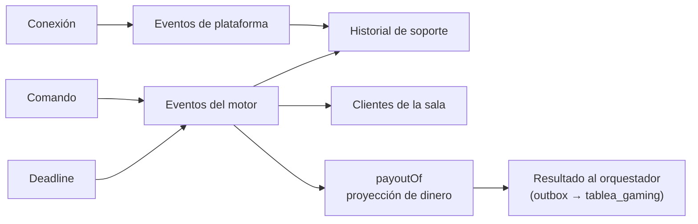

# API HTTP y mensajes

El juego usa WebSocket/Colyseus para la partida y HTTP para configuración, operación y la API del
orquestador. Dominó no tiene catálogo de modos: los modos son del orquestador, que los lee y los edita,
y manda el modo entero en cada mesa casual (`gameMode`, en «API del orquestador»). No hay Swagger: los mensajes de sala no son HTTP y los contratos se mantienen
tipados en el código.

## Salas Colyseus

| Sala | Quién entra | Estado principal |
|---|---|---|
| `domino` | Participante reservado con JWT válido | Partida, ronda, jugadores, tablero, pozo, turnos y deadlines |

Es la única sala. No hay lobby ni emparejamiento en este servidor: los hace el orquestador, que abre
cada mesa por `POST /internal/matches` y le entrega a cada jugador su reserva de asiento. El jugador
se conecta con esa reserva y su JWT; el `sub` del token es el `userId` con el que el orquestador lo
sentó, normalizado con `trim()`.

## Mensajes de la sala `domino`

| Tipo | Payload del cliente | Efecto |
|---|---|---|
| `REVEAL_TILES` | `{}` | Confirma que el jugador levantó su mano durante `DEALING` |
| `PLAY_TILE` | `{ left, right, side }` | Coloca una ficha legal en `LEFT` o `RIGHT` |
| `DRAW_TILE` | `{}` | Toma del pozo cuando no tiene jugada |
| `PASS` | `{}` | Pasa cuando no puede jugar ni cargar |
| `ABANDON` | `{}` | Abandono voluntario |
| `PROPOSE_BET_MULTIPLIER` | `{ level }` | Congela el turno y abre la negociación |
| `RESPOND_BET_MULTIPLIER` | `{ accept }` | Acepta o rechaza la propuesta vigente |
| `SEND_REACTION` | `{ reactionId }` | Manda un gesto a la mesa (ver «Reacciones») |

El cliente no envía `playerId`: el handler lo toma del asiento autenticado. Cada payload pasa por un
decoder estricto antes de alcanzar el comando.

**Tope de mensajes**: cada conexión puede mandar hasta `MAX_MESSAGES_PER_SECOND` mensajes por segundo
(default **25**); el que pasa el tope pierde la conexión (Colyseus la cierra con `1011`) y puede volver
con su reserva o su token de reconexión. Los rechazos (`illegal`) se contestan siempre; en el log del
servidor salen muestreados, cinco por minuto por asiento y clase, más una línea con los que se callaron.

### Reacciones

`SEND_REACTION` `{ reactionId: string }` (de 1 a 64 caracteres; un campo de más, como el
`targetPlayerId` del front viejo, se ignora) pone un gesto del catálogo en la mesa: la sala lo
difunde a **todos**, el que lo mandó incluido, como `REACTION_SENT`. El cliente manda el id y el
contenido lo pone el servidor, así que no es un chat.

- `fromPlayerId` es el asiento que lo mandó (`seat-1`, `seat-2`…), el mismo `playerId` de
  `state.players[]`: el cliente lo ubica con `players.find((p) => p.playerId === fromPlayerId)`.
- Puede mandar cualquier jugador sentado en la sala, en cualquier fase mientras la sala esté
  abierta: el reparto, la mano, entre manos y la pantalla del resultado.
- **Límite:** 3 gestos cada 2 s por jugador, ventana deslizante, por mesa.
- **Los rechazos son silenciosos:** un id que no está en el catálogo o un gesto por encima del límite
  no se difunden ni devuelven nada (quedan en el log de debug). Sólo el payload malformado (sin
  `reactionId`, o de otro tipo) contesta `illegal` con `MALFORMED`.
- No toca la partida: no cambia el estado, no produce `events` y no entra en el historial ni en el
  registro de la partida.

La lista de gestos la sirve `GET /reactions` (ver «HTTP público»).

## Mensajes del servidor

Lo que la sala `domino` le manda al cliente, además del estado sincronizado.

| Tipo | A quién | Payload | Cuándo |
|---|---|---|---|
| `config` | Al que entra o vuelve, y sólo a él | La config pública de la mesa, **su** asiento (`seat`) y `serverNow` (forma abajo) | Al final de cada entrada (`onJoin`) y de cada reconexión (`onReconnect`) |
| `events` | Toda la mesa | Lista de eventos del motor y de plataforma (`ROUND_STARTED`, `MATCH_RESOLVED`, `PLAYER_RECONNECTED`…) | Cada vez que la partida produce hechos |
| `illegal` | El que mandó el mensaje | `{ code, detail? }`: `code` es el de la regla violada, `MALFORMED` (con `detail`) o `UNKNOWN_COMMAND` | Su mensaje no prosperó; el estado no cambió |
| `matchCancelled` | Toda la mesa | `{ reason: "CHARGE_REJECTED" \| "SEATING_TIMEOUT" }` | `CHARGE_REJECTED`: el orquestador no cobró la entrada. `SEATING_TIMEOUT`: venció el plazo de ocupación sin que todos entraran (sale abortada `NEVER_STARTED`, sin cobro). En los dos la sala se cierra sin arrancar, con 4000, justo después |
| `REACTION_SENT` | Toda la mesa, el que lo mandó incluido | `{ fromPlayerId, reaction: { id, type, content } }` | Un jugador mandó un gesto válido dentro del límite (`SEND_REACTION`) |

**`config`** es UN MENSAJE POR ASIENTO: la mesa (lo mismo para todos) más lo de quien lo recibe. Es la
única vía de la config: no hay ruta HTTP.

```ts
{
  mode: "CASUAL" | "TOURNAMENT";
  tournamentId?: string;        // solo en una mesa de torneo
  matchId: string;
  gameModeId: string;           // en una de torneo, "tournament:<tournamentId>"
  seats: string[];              // ids opacos: "seat-1", "seat-2"…
  pointsToWin: number;
  currency: "UC";               // la moneda de la mesa: siempre UC (ver «Montos», abajo)
  entryFee: string;             // "125.0000"
  prize: string;                // "250.0000"
  // `extra` y `additionalPoints` NO son plata: pesos de los puntos del ranking. Siguen siendo números.
  betLevels: { level: number; extra: number; additionalPoints: number }[]; // [] = no ofrece aumentar
  isFreeRoom: boolean;
  enableBots: boolean;
  timeouts: { turnMs: number; extraTimeMs: number; dealingMs: number; betResponseMs: number };
  // EL ASIENTO DE QUIEN LO RECIBE, y de nadie más.
  seat: {
    playerId: string;           // su asiento: el `playerId` de `state.players[]`
    // Lo que la mesa le cuesta y le paga EN SU MONEDA. Sólo si su asiento trajo `price` en el pedido
    // (ausente en una mesa gratis o de torneo: sigue en UC con los montos de la mesa).
    price?: {
      currency: string;         // su moneda, el código de billing tal cual: "VES"
      rateId: string;           // la tasa de la mesa, con la que billing cotizó estos montos
      rate: string;             // lo que vale 1 UC en `currency`, como lo congeló billing
      entry: string;            // lo que costó sentarse: "25000.00"
      prize: string;            // lo que cobra cada ganador sin aumento
      levels: { level: number; entry: string; prize: string }[]; // subir a ese nivel cobra `entry`
    };
  };
  serverNow: number;            // epoch ms del servidor al mandarlo, para el desfase de reloj
}
```

El front encuentra su asiento con `seat.playerId` (`players.find((p) => p.playerId === seat.playerId)`),
también antes de revelar las fichas: el estado no lleva el `userId` de nadie. Pinta entrada, premio y cada
aumento con `seat.price`, en la moneda del jugador; sin `price`, en UC con los montos de la mesa. Los montos
en su moneda son los que cotizó billing: no se convierten ni se redondean, y se rellenan con los decimales
de la moneda solo si el orquestador los mandó (`price.decimals`). Lo que eso vale en UC es lo de la mesa:
`entryFee`, `prize`, y para el nivel N `entryFee × (N − 1)` (`betDifference`) y `prize × N` (`stakeAt`); quien quiera la conversión exacta
consulta la tasa `rateId` (`GET /v1/rates/:rateId` de billing, por el gateway).

**Lo de un asiento no le llega a otro.** El mensaje nunca lleva el `userId`, el proveedor, la moneda ni el
precio de otro asiento (antes `seatPrices` traía el precio de todos: en una mesa cruzada, el jugador de un
proveedor veía la moneda y lo que pagaba el del otro). Lo arma `seatConfigOf` (`transports/match-registry.ts`)
campo por campo, con el `playerId` que `onJoin` dejó en el `userData` de esa conexión.

Nunca lleva el `seed`. La moneda, la tasa y el `rateId` salen sólo dentro de `seat.price`, del asiento
propio. Lo que la sala manda en `onJoin` Colyseus lo
encola hasta que el cliente confirma la entrada, así que llega apenas resuelve el `join` y antes de
cualquier `events` posterior. El handler se registra **justo después del `join`, sin un `await` en
el medio** (por ejemplo, no después de `waitForInitialState()`): si no, el mensaje llega antes que el
handler. Un cliente que no lo escucha solo ve un aviso del SDK.

## Estado visible

`StateView` filtra el árbol por cliente:

- Cada jugador ve sus fichas y sólo el conteo de las fichas rivales.
- Nadie ve el contenido del pozo; sí ve cuántas quedan.
- `displayName`, `username` y `profilePicture` son presentación sincronizada: es la excepción aceptada de
  lo que un jugador ve del asiento rival (en una mesa cruzada la foto llega ya sellada por el proxy del
  orquestador).
- **El estado es de toda la mesa**, y en una cruzada la mesa tiene jugadores de dos proveedores: ningún
  campo sincronizado es privado de un asiento. La lista cerrada de lo que `PlayerState` sincroniza la fija
  `core/state/state.test.ts`; un campo nuevo sin vista la pone en rojo.
- El `userId` (el `sub` del token) **no viaja**: `PlayerState.userId` es `noSync()`, queda del lado del
  servidor para la guarda del pago (`assertSameTable`). El cliente reconoce su asiento por el `seat.playerId`
  de su mensaje `config`. Antes viajaba en cada asiento, y el jugador de un proveedor veía el del rival.
- Ni la moneda ni el proveedor son del estado: viven en el `seat` de la config del servidor.
- La oferta de aumento en curso (`currentRound.betOffer`) lleva `additionalEntryFee`, lo que le cuesta
  aceptar a cada asiento, como texto decimal en UC (`"125.0000"`): la moneda es la de la mesa, el
  `currency: "UC"` del mensaje `config`. Es de toda la mesa: lo mismo en la moneda de cada uno está en
  `seat.price.levels` de su mensaje `config`.
- Las fichas colocadas, el turno, puntajes, fases y deadlines son públicos.

## HTTP público

| Método y ruta | Uso |
|---|---|
| `GET /health` | Liveness del proceso; nunca consulta dependencias |
| `GET /ready` | Readiness; responde `503` y lista dependencias faltantes |
| `GET /me/matches?page=&limit=` | Historial del dueño del token (`Authorization: Bearer <JWT>`): sus partidas terminadas, la más nueva primero, desde su asiento (`id` es el `matchId`, `roomId` la sala de Colyseus; `result`, `score`, `playedAt`; y `currency`, `bet` y `prize` en la convención de montos: `{ currency: "VES", bet: "400.00", prize: "720.00" }` si su asiento se sentó con `price` —la moneda congelada al cerrar—, y en `UC` si no). Página de 1 a 50, 10 por defecto |
| `GET /reactions` | La lista de gestos de `SEND_REACTION`, sin credencial (ver abajo) |

**`GET /reactions`** responde con `Cache-Control: public, max-age=300` la lista fija del dominó (vive
en el código, `src/features/reactions/static-catalog.ts`, y es la misma para todos los proveedores):
un solo paquete, `global`, con 24 emojis en el orden en que se dibujan.

```json
[{ "pack": "global", "items": [{ "id": "grin", "type": "emoji", "content": "😀" }, …] }]
```

Los ids, en orden: `grin` 😀, `joy` 😂, `cool` 😎, `heart-eyes` 😍, `angry` 😡, `sob` 😭,
`thumbs-up` 👍, `thumbs-down` 👎, `pray` 🙏, `muscle` 💪, `victory` ✌️, `fire` 🔥, `zzz` 💤,
`thinking` 🤔, `sleeping` 😴, `mind-blown` 🤯, `scream` 😱, `huffing` 😤, `devil` 😈, `skull` 💀,
`trophy` 🏆, `dollar` 💵, `money-bag` 💰, `money-mouth` 🤑.

Todas las respuestas HTTP exponen el header `Date`, que permite recalcular el desfase del reloj del
cliente. La medición inicial es el `serverNow` del mensaje `config`.

`GET /config/:roomId` y `GET /matches/:roomId` **ya no existen** (2026-11-11): la config llega sólo por el
mensaje `config` de la sala, por asiento. Responden el 404 por defecto de Express.

## HTTP interno

Estas rutas requieren una de dos credenciales:

- el header `x-internal-api-key` con la llave de administración (scripts y soporte). Vale como un
  admin de **Tablea Gaming** con rol `admin`;
- `Authorization: Bearer <token>` con el token de admin que billing-auth emite cuando un admin inicia
  sesión (`POST /v1/auth/login` de billing-auth): ES256, audiencia `tablea-gaming-admin` y
  `typ: admin`. Sus claims `prv` (el proveedor del admin; `null` es Tablea Gaming) y `role` (`admin` o
  `support`) dicen qué abre, y son **obligatorias**: un token sin `prv` (texto o `null` explícito) o
  sin `role` es `401`, igual que un rol desconocido o un `prv` vacío o que no es texto.

Si `ADMIN_API_KEY` no existe, no se registran y responden 404: fallan cerradas. Los errores de todas
salen `{ code, detail? }` (ver [«Errores»](#errores)).

**Quién entra.** El default es el cerrado: una ruta es de Tablea Gaming y de escritura salvo que diga
lo contrario. `support` sólo lee. Un admin de **proveedor** sólo entra a las rutas que acotan su
ámbito —el listado y el detalle de partidas—; en todas las demás recibe
`403 { code: "FORBIDDEN" }`.

| Rutas | Tablea Gaming `admin` (y la llave) | Tablea Gaming `support` | Proveedor `admin` | Proveedor `support` |
|---|---|---|---|---|
| `GET /internal/matches`, `GET /internal/matches/:matchId` | todo (o el proveedor de `?providerId=`) | ídem | sólo las partidas con algún asiento suyo, el asiento ajeno recortado | ídem |
| `GET /internal/matches/:matchId/history`, `GET /internal/players/:userId/matches`, `/game-data/:roomId` | sí | sí | 403 | 403 |
| `GET /internal/settings…` | sí | sí | 403 | 403 |
| `PATCH`/`DELETE /internal/settings/:section` | sí | 403 | 403 | 403 |

| Método y ruta | Uso |
|---|---|
| `GET /internal/matches/:matchId/history` | Historial ordenado por `seq` para soporte (lee `timeline` y, en los documentos viejos, `entries`) |
| `GET /internal/matches?pageSize=&after=&from=&to=&matchId=&roomId=&id=&userId=&matchEndReason=&status=&tournamentId=&providerId=` | Listado de partidas para el panel, la más nueva primero, filtrado y paginado por cursor; un proveedor ve sólo las suyas (ver «El registro de cada partida») |
| `GET /internal/matches/:matchId` | El documento guardado de una partida: entero para Tablea Gaming; a un proveedor, sólo si algún asiento es suyo, y con el asiento ajeno recortado |
| `GET /game-data/:roomId` | El documento guardado, pelado, para el detalle de movimientos del backend principal |
| `GET /internal/players/:userId/matches?page=&limit=` | Historial de un jugador para el panel: la misma página que `GET /me/matches` le devuelve a ese `userId` (mismos parámetros y límites), dentro de `{ status: "success", data }`. El `userId` sigue la regla de texto del filtro del listado |
| `GET /internal/settings` | Las secciones de config en caliente (`match`; en local y dev también `deal` y `starting-score`): en vigor, overrides y editables |
| `GET /internal/settings/:section` | Una sección |
| `PATCH /internal/settings/:section` | Parche de uno o más campos; cotas estrictas, clave desconocida = 400 |
| `DELETE /internal/settings/:section` | Vuelve la sección a los defaults del entorno |

### El registro de cada partida

Cada partida deja **un documento** en `match_history`, con la forma v2.1 de truco (`version: 2.1`). Se
abre al primer reparto (`status: "started"`, con `roomId`, `table`, `matchConfig` —seed y parejas
incluidos—, `seats` y `matchStartedAt`), se alimenta durante la partida (`timeline`, la secuencia de
actos y hechos; `rounds`, lo que las reglas concluyeron de cada mano) y se cierra al terminar
(`status: "finished" | "aborted"`, `matchEndedAt`, `matchDurationInMs`, `matchEndReason`, ganadores,
`players` con su salida y su plata, `rateId`, `betMultiplier` y `rankingMultiplier`). Un asiento que se
sentó con `price` lo guarda en `seats[]` y `players[]`, y su plata suma `chargedInPlayerCurrency` y
`prizePaidInPlayerCurrency` (texto decimal, elegidos del precio con la regla de UC). Así queda **en
Mongo**; las cuatro rutas que lo leen lo devuelven con los montos en la convención (ver «El registro en
la convención de montos», abajo) y por audiencia (ver «Quién ve qué del registro»). Cada asiento guarda
su `providerId` en `seats[]` y `players[]`. Una mesa que nunca
arrancó nace en el cierre. Los instantes son fechas (ISO en el JSON); las duraciones, números. Los
documentos de antes de la v2.1 (`{ matchId, entries, createdAt, updatedAt }`) se siguen leyendo en las
cuatro rutas.

**`GET /internal/matches`** — el listado del panel, la más nueva primero (`createdAt` descendente y
`_id` de desempate), paginado **por cursor**. Todos los parámetros son opcionales y los filtros se
combinan con AND:

| Parámetro | Qué es | Inválido (400 `MALFORMED`) |
|---|---|---|
| `pageSize` | Filas por página, entero de 1 a 100; default 20 | fuera de rango, no entero |
| `after` | El `nextCursor` de la página anterior, tal cual | cualquier cosa que no sea un cursor emitido por esta ruta |
| `from`, `to` | Instantes ISO 8601 **con hora y zona** (`2026-10-01T00:00:00.000Z`, `…-04:00`): `createdAt >= from` y `createdAt < to` | una fecha sin hora, un instante imposible, `from` posterior a `to` |
| `matchId` | Igual a | vacío, más de 128 caracteres, caracteres de control |
| `roomId` | Igual a | ídem |
| `id` | El `_id` del documento: 24 hexadecimales | otra cosa |
| `userId` | Un jugador: igual al `userId` de **alguno** de los asientos (`seats[].userId`), en mesas de dos o de cuatro. Una partida en la que el mismo usuario ocupa dos asientos sale una vez. Los documentos de antes de la v2.1 no tienen asientos y no coinciden nunca | ídem `matchId`, o repetido |
| `matchEndReason` | El motivo del cierre, exacto: `SCORE`, `ABANDONMENT`, `NEVER_STARTED`, `TILES_NOT_SEEN`, `NEVER_PLAYED`, `INTERRUPTED` o `CHARGE_REJECTED`. Una partida todavía abierta no tiene motivo y no coincide con ninguno | otro valor (en minúsculas incluido), vacío o repetido |
| `status` | El estado del documento, exacto: `started` (abierta), `finished` o `aborted`. Sin él salen todos los estados. Los documentos de antes de la v2.1 no tienen estado y no coinciden nunca | otro valor (en mayúsculas incluido), vacío o repetido |
| `tournamentId` | Un torneo: igual al `table.tournamentId` de la mesa. Una casual y los documentos viejos no lo llevan y no coinciden nunca | ídem `matchId`, o repetido |
| `providerId` | Un proveedor: igual al `providerId` de **alguno** de los asientos (`seats[].providerId`). Una casual cruzada sale para los dos proveedores, y una vez aunque el proveedor ocupe dos asientos. Una partida grabada sin el campo no coincide nunca. **Un admin de proveedor siempre lo tiene puesto con el suyo**: nombrar el suyo es lo mismo, y nombrar otro responde `404 { code: "UNKNOWN_PROVIDER" }` | ídem `matchId`, o repetido |

Un parámetro que no está en la tabla se ignora (`page` incluido: ya no existe). `from` igual a `to` es
un rango vacío, no un error.

```json
{
  "status": "success",
  "data": {
    "items": [
      {
        "_id": "6717a2f0c3bf3e710572f941",
        "matchId": "orq-8f2c",
        "roomId": "ZYIVoz6TQ",
        "game": "domino",
        "status": "finished",
        "table": { "gameModeId": "…", "name": "Clásica 1v1", "currency": "UC", "entryFee": "10.0000", "prize": "18.0000", "isFree": false },
        "createdAt": "2026-10-22T14:00:00.000Z",
        "updatedAt": "2026-10-22T14:09:31.000Z",
        "matchStartedAt": "2026-10-22T14:00:03.000Z",
        "matchEndedAt": "2026-10-22T14:09:00.000Z",
        "matchEndReason": "SCORE",
        "winnerIds": ["seat-1"]
      }
    ],
    "pageSize": 20,
    "nextCursor": "eyJ0IjoxNzkyNjc3NjAwMDAwLCJpZCI6IjY3MTdhMmYwYzNiZjNlNzEwNTcyZjk0MSJ9",
    "total": 1234,
    "totalExact": true
  }
}
```

- **`nextCursor`** es opaco (base64url de `{ t, id }`: el `createdAt` en epoch ms y el `_id` de la última
  fila) y es `null` en la última página. La página siguiente se pide con `after=<nextCursor>` **y los
  mismos filtros**; empieza estrictamente después de esa fila, así que un empate en el mismo
  milisegundo no repite ni pierde filas, y una página honda cuesta lo mismo que la primera.
- **`total`** se cuenta barato: sin filtros es el estimado de la colección (`totalExact: false`); con
  algún filtro se cuenta hasta 10 000 (`totalExact: true`, o `total: 10000` y `totalExact: false` si
  hay más); con `after` no se cuenta (`total: null`, `totalExact: false`).
- **Plazo**: cada consulta tiene 5 s. Si la base no contesta a tiempo:
  `503 { code: "MATCH_LIST_TIMEOUT", detail: "La búsqueda tardó demasiado; acota el rango de fechas" }`.

Cada fila es un resumen: sin `timeline` ni `rounds`. Un documento viejo aparece con lo que tiene
(`_id`, `matchId`, `game`, `createdAt`, `updatedAt`) y sale en todo listado que no filtre por sala.

**`GET /internal/matches/:matchId`** — `200 { status: "success", data: <documento> }`, con el `_id`
como texto y `rounds`/`timeline` al final; `404 { code: "MATCH_NOT_FOUND" }`. A un admin de proveedor,
el mismo `404` si ningún asiento lleva su `providerId` (una partida grabada sin el campo sólo la ve
Tablea Gaming).

**Quién ve qué del registro** (`recordView(stored, audience)`, `network/record-view.ts`). La audiencia sale
del admin (`adminOf(response).provider`):

| Audiencia | La mesa (cabecera, `timeline`, `rounds`, `winnerIds`…) | Sus asientos | El asiento de otro proveedor |
|---|---|---|---|
| Tablea Gaming (la llave, o un token con `prv: null`) | entera | enteros | entero |
| Un proveedor (`prv: "<id>"`) | entera | enteros (`seats[]` y `players[]` con su `providerId`) | **lista cerrada**: `id`, `teamId`, `seat`, `displayName`, `username`, `finalScore`, `exit`, `connection` |

Del asiento ajeno no salen `userId`, `providerId`, `currency`, `price`, `rateId` ni ningún monto
(`charged`, `prizePaid`). Es una lista de permitidos: un campo que el registro agregue mañana no sale al
rival hasta que alguien lo agregue a `RIVAL_SEAT_FIELDS`. La mesa es de los dos (es la partida que jugó su
jugador): su timeline lleva sólo `playerId` (`seat-N`) y montos en UC. El residuo aceptado es deducir el
resultado del rival de lo que la mesa muestra. `/game-data` y el historial de soporte siguen siendo sólo de
Tablea Gaming, que ve todo.

**`GET /game-data/:roomId`** — el contrato del backend principal, igual que en truco: `200` con el
documento pelado (sin envelope y sin `_id`) y `404 { code: "MATCH_NOT_FOUND" }`. Busca por `roomId` y,
si no, por `matchId` (los documentos viejos no guardaban la sala).

Las tres van con la llave o el token de admin; sin credencial, `401 { code: "UNAUTHORIZED" }` antes de
mirar la forma. El `POST /internal/matches` del orquestador es otra ruta, con su llave.

**El registro en la convención de montos.** Mongo guarda los montos en UC de los campos `*InUC` como
texto con 4 decimales (`"10.0000"`); los documentos escritos antes los tienen como número (`10`), no se
migran, y los dos se leen igual (`storedUcOf`). El listado, el detalle, `/game-data` y
`GET /internal/matches/:matchId/history` los traducen al salir
(`network/record-view.ts`): **la mesa en UC y cada asiento en su moneda**, cada uno con su `currency`.
Lo que no reconocen lo dejan como está: un documento de antes de la v2.1 sale igual, y un campo que
falta no se inventa.

| En Mongo | En la respuesta |
|---|---|
| `table.entryFeeInUC: "10.0000"` (o `10`), `table.prizeInUC: "18.0000"` (o `18`) | `table: { currency: "UC", entryFee: "10.0000", prize: "18.0000", … }` |
| `seats[].price`, `players[].price`: `{ currency, rate, entry, prize, levels, decimals? }` | `{ currency: "VES", rateId, rate, entry: "4000.00", prize, levels }`: rellenado con `decimals`, con el `rateId` de la partida (sin él mientras la partida sigue abierta, porque el documento todavía no lo tiene) |
| `players[]`: `chargedInUC: "20.0000"` (o `20`), `prizePaidInUC: "36.0000"` (o `36`), `chargedInPlayerCurrency: "4000.00"`, `prizePaidInPlayerCurrency: "7200.00"` | `players[]: { currency: "VES", rateId, …, charged: "4000.00", prizePaid: "7200.00" }`; sin montos en su moneda (sin precio, o un aumento que el precio no cotizó), `{ currency: "UC", rateId, …, charged: "20.0000", prizePaid: "36.0000" }` |
| `betMultiplier.resultingEntryFeeInUC`, `resultingPrizeInUC` | `betMultiplier: { currency: "UC", resultingEntryFee, resultingPrize, … }` |
| `timeline[]` `MULTIPLIER_AGREED`: `payload.additionalEntryFee: 125` | `payload: { currency: "UC", additionalEntryFee: "125.0000", … }` |

En `players[]`, `currency` es la moneda de los montos del asiento y va primero, con el `rateId` de la
partida. En `seats[]` (el armado, sin montos propios) `currency` sigue siendo la moneda de la billetera
que congeló el asiento. `rankingMultiplier` y `betMultiplier.offeredValues`/`finalValue` no son plata.

**Config en caliente.** Una edición llega a las mesas que nacen DESPUÉS; una mesa ya abierta conserva
los plazos con los que nació. El proceso que atiende el `PATCH` se refresca en el acto y el resto
del clúster converge en 5 s. Fuera de lo editable queda `tilesPerPlayer` (regla de juego): se rechaza
con 400 en vez de aceptarse e ignorarse.

### API del orquestador

Cinco rutas que sólo usa el orquestador de Tablea Gaming; las de las mesas son la única puerta
de entrada a una partida. Van con `x-internal-api-key` igual a
`ORCHESTRATOR_API_KEY` (`ADMIN_API_KEY` no las abre); sin esa variable no se registran y responden 404.
Un `401 { code: "UNAUTHORIZED" }` es una llave ausente o equivocada, y se decide ANTES de mirar el
cuerpo.

**`POST /internal/matches`** abre una mesa. Cuerpo (`CreateMatchRequest`, estricto: una clave de más
es 400), discriminado por `mode`:

- **`"CASUAL"`**: `matchId`, `gameModeId` (el uuid del modo en el catálogo del orquestador; dominó no lo
  resuelve, nombra la mesa), `gameMode` (**obligatorio**: el modo en línea, abajo), `participants` (2 a
  4, par; cada uno `userId`, `displayName`, `currency` y, opcionales, `username`, `profilePicture`,
  `price` y `providerId`), `seed`, `teamAssignment` (`SHUFFLED` o `SEAT_ORDER`), `rateId` (opaco: el
  `_id` de Mongo de la tasa de Betaso) y `betLevels` opcional (abajo).
- **`"TOURNAMENT"`**: `matchId`, `tournamentId`, `participants` y `teamAssignment` como la casual,
  `seed` y `rules: { pointsToWin }` (entero positivo seguro; el tope lo decide `apps/tournaments`, no
  el dominó, cuyo motor solo usa `pointsToWin` como meta). **Sin** `gameModeId`, `gameMode`, `rateId` ni
  `betLevels`: traer alguno es 400. Es gratis (`isFreeRoom`, entrada y premio 0),
  sin aumentos, sin bots y sin revancha, con la ventana de reparto y los plazos de cualquier mesa
  (la config global, con sus ediciones en caliente). Con la mesa completa **arranca sin pedir cobro**
  al orquestador. En el snapshot, el registro y el censo su `gameModeId` es
  `"tournament:<tournamentId>"` y su `rateId` es `"none"`.

| Estado | Cuerpo | Cuándo |
|---|---|---|
| `201` | `{ status, data: { roomId, seats: [{ userId, reservation }] } }` | La sala nació; cada jugador consume su `reservation` |
| `400` | `{ code: "MALFORMED", detail }` | El cuerpo no cumple la forma |
| `401` | `{ code: "UNAUTHORIZED" }` | Llave ausente o equivocada |
| `400` | `{ code: "MALFORMED", detail }` | También: una casual sin `gameMode`, o con un `gameMode` fuera de su forma; y **toda mesa de cuatro** (`gameMode.playersQuantity: 4`, o más de dos `participants`, casual o de torneo) |
| `409` | `{ code: "MATCH_OPENING" }` | Otro pedido con el mismo `matchId` está abriendo la sala y no terminó en 5 s. Reintentable |
| `422` | `{ code: "SEAT_COUNT_MISMATCH" }` | La sala rechazó la mesa: la cantidad de `participants` no es la del modo. Con sólo mesas de dos ya no se puede pedir por esta ruta (un modo de dos con dos participantes siempre coincide); queda como guarda de la sala |
| `500` | `{ code: "INTERNAL" }` | Cualquier otra falla es nuestra |

**Una sala por `matchId`.** Si la partida ya tiene sala viva —el orquestador reintentó un `POST` cuya
respuesta se perdió—, la respuesta es `201` con **esa** sala y reservas nuevas, una por participante; no
se abre otra. Dos pedidos simultáneos del mismo `matchId` los ordena un candado en Redis
(`match_opening:<matchId>`, `SET NX` de 30 s): el que lo toma abre la sala y los demás esperan a que
aparezca en el registro (hasta 5 s) y reservan en ella. Una partida cuya sala ya se cerró **no** tiene
sala viva: un `POST` con ese `matchId` abre una nueva (el orquestador no debe repetir una partida
terminada).

**`POST /internal/players/:userId/seat`** devuelve el asiento de quien sigue jugando (sin cuerpo).

| Estado | Cuerpo | Cuándo |
|---|---|---|
| `200` | `{ status, data: { matchId, mode, tournamentId?, reservation } }` | Sigue en una mesa; el `matchId` es el del orquestador; `mode` es `CASUAL` o `TOURNAMENT` y `tournamentId` va solo en una de torneo |
| `400` | `{ code: "MALFORMED", detail }` | El `userId` es inválido |
| `401` | `{ code: "UNAUTHORIZED" }` | Llave ausente o equivocada |
| `404` | `{ code: "NO_LIVE_MATCH" }` | No está en ninguna mesa viva, o su sala ya no existe (proceso muerto): la entrada del jugador se borra |
| `500` | `{ code: "INTERNAL" }` | La reserva falló y la sala sigue en el registro de salas (o no se pudo confirmar en 2 s): el orquestador lo trata como desconocido y nunca abre una segunda mesa |

**`GET /internal/players/:userId/match`** dice en qué mesa está sentado un jugador, **sin reservar
asiento**: dos lecturas del registro compartido y una lectura del registro de salas de Colyseus (`matchMaker.query`, plazo 2 s). Es lo que el orquestador
pregunta para no abrirle una segunda mesa; para volver a entrar sigue siendo `POST .../seat`.

| Estado | Cuerpo | Cuándo |
|---|---|---|
| `200` | `{ status: "success", data: { matchId, roomId, mode, tournamentId? } }` | Sigue en una mesa viva; el `matchId` es el del orquestador; `mode` y `tournamentId` como en `.../seat` |
| `400` | `{ code: "MALFORMED", detail }` | El `userId` es inválido |
| `401` | `{ code: "UNAUTHORIZED" }` | Llave ausente o equivocada |
| `404` | `{ code: "NO_LIVE_MATCH" }` | No está en ninguna mesa viva (o ya lo soltó: se retiró, la partida tiene veredicto o se anuló), o su sala ya no figura en el matchmaker: la entrada se borra |

**`GET /internal/matches/:matchId/existence`** dice si una partida existe y en qué está su desenlace, y
**nada más**:

- **`live`**: su mesa sigue viva en el clúster (el registro compartido, la misma prueba que `.../seat`: su
  sala anotada por `matchId` y la config de esa sala presente).
- **`recorded`**: quedó registro de ella (el archivo de partidas, sin leer el documento).
- **`outcome`**: su desenlace en el outbox de resultados (`match_result_outbox`, claves
  `<matchId>:finished` y `<matchId>:aborted`):
  - `"none"`: no hay ninguno;
  - `"pending"`: hay uno que todavía no salió (`PENDING`, o `PARKED` esperando que alguien lo reproduzca);
  - `"published"`: el broker lo confirmó (`SENT`). Lo enviado no se borra nunca (a los 7 días pierde el
    cuerpo y queda la lápida), así que una partida publicada sigue contestando `published`.

El orquestador aborta el ledger de una mesa casual paga —reembolsa las entradas— **sólo** con
`live: false && outcome: "none"` pasada la duración máxima de una partida; también lo pregunta antes de dar
por perdida una mesa de torneo. El documento sigue siendo del panel (`GET /internal/matches/:matchId`, con
`ADMIN_API_KEY`); esta ruta no lo devuelve.

| Estado | Cuerpo | Cuándo |
|---|---|---|
| `200` | `{ status: "success", data: { live, recorded, outcome } }` | Siempre que el registro, la base y el outbox contestan |
| `400` | `{ code: "MALFORMED", detail }` | El `matchId` es inválido |
| `401` | `{ code: "UNAUTHORIZED" }` | Llave ausente o equivocada |
| `503` | `{ code: "UNAVAILABLE" }` | El registro compartido, la base o el outbox no contestaron: **nunca** un `false` ni un `"none"` por una falla |

El registro de una partida se escribe al **arrancar** el juego (el primer reparto, `MatchHistory.open`), y cada
lote del juego lo crea si falta; las escrituras son de mejor esfuerzo. Una sala creada que nadie llegó a jugar
no tiene registro (sale `aborted` por el outbox de resultados igual).

**`GET /internal/census`** cuenta quién está jugando, en todo el clúster: el total y por **(proveedor,
moneda, mesa)**. La mesa es el modo de una casual (`gameModeId`) o el torneo de una de torneo
(`tournamentId`), **exactamente uno de los dos**. El orquestador decide con esto qué ve cada proveedor: los
grupos casuales de los modos que ofrece y los torneos suyos, sin perder el número de los demás.

| Estado | Cuerpo | Cuándo |
|---|---|---|
| `200` | `{ status, data: { playersInMatch, groups: [{ providerId, currency, gameModeId? \| tournamentId?, playersInMatch }] } }` | Siempre; un grupo sin nadie jugando no aparece |
| `401` | `{ code: "UNAUTHORIZED" }` | Llave ausente o equivocada |

`groups` suma exactamente `playersInMatch`: todo asiento tiene proveedor. Ya no hay `byGameMode` ni
`byTournament` (quien los necesite los suma de `groups`), ni `providerId: null`.

Todos los números cuentan los asientos que siguen jugando (el que se retiró o terminó sale en el acto) de
las salas que latieron en el último minuto. Cada sala escribe su propia entrada en el hash compartido
`live_seats` (`{ seats, groups: [{ providerId, currency, gameModeId | tournamentId, seats }], at }`) y el
censo las lee todas (`hgetall`) y las suma por la tupla (proveedor, moneda, modo, torneo).

| Caso (interleaving) | Qué pasa |
|---|---|
| Asientos en varios procesos | Cada sala escribe SU campo del hash (`hset` por `roomId`); nadie escribe el de otra, así que dos escrituras concurrentes nunca se pisan. El censo suma lo que lee |
| Un jugador se retira o la mesa termina mientras alguien lee | `settle` o `keepAlive` reescribe la entrada entera con los activos; el lector ve la de antes o la de después, nunca una mezcla (un `hset` es atómico). Sale de su grupo y no vuelve: soltar es irreversible |
| Un latido del reloj y un `settle` de la misma sala a la vez | Van en la misma fila de la sala (`beats`), uno detrás del otro; los dos escriben desde la lista de activos que ya se achicó |
| Una sala dejó de latir (proceso muerto) | A los 60 s deja de contar, en el total y en los grupos; a los 120 s el censo la borra |
| Despliegue con procesos de dos versiones | La entrada de la versión anterior (sin `groups`, grupos sin mesa o con `providerId: null`) no se lee de otra forma: no cuenta y el censo la borra; su sala la reescribe en el próximo latido y vuelve a no contar, hasta que su proceso se reemplaza. Un censo de la versión anterior también borra las entradas nuevas (le falta el `gameModeId` de arriba). Durante el reemplazo el censo puede contar de menos; nunca de más |
| Una entrada corrupta | No cuenta y se borra |

Lo pinean `match-registry.test.ts` («censo del lobby», «censo por proveedor, moneda y mesa», y los de
latidos concurrentes) y `tables.int.test.ts`.

⚠ **El dominó no verifica el modo ni el proveedor al abrir una mesa.** `POST /internal/matches` juega el
modo que le mandan: que exista, esté activo y sea de los que el proveedor del jugador ofrece lo
garantiza el orquestador.

El `CreateMatchRequest` casual acepta además `betLevels` (opcional, `[{ level, extra, additionalPoints }]`):
los niveles de aumento que ofrece la mesa los decide el orquestador, que es quien los cobra.

**`participants[].providerId`** (**obligatorio**, en la casual y en la de torneo, desde 2026-11-11) es el
proveedor del jugador (el `prv` de su sesión en billing-auth), con la regla de texto del `userId` (sin
vacíos; se recortan los espacios). Sin él el pedido es `400 MALFORMED`: no hay asientos sin atribuir. La
mesa no lo usa para jugar: lo guarda en `seats[]` y `players[]` del registro, decide qué ve cada proveedor
del registro y agrupa el censo.

**`participants[].price`** (opcional) es lo que la mesa le cuesta y le paga a ese jugador **en su
moneda**, con la cotización de billing:

```jsonc
"price": {
  "currency": "VES",          // la misma que participants[].currency (si no, 400)
  "rate": "200",              // la tasa congelada, texto
  "entry": "200.00",          // lo que cuesta sentarse
  "prize": "300.00",          // lo que cobra cada ganador sin aumento
  "levels": [ { "level": 2, "entry": "200.00", "prize": "600.00" } ], // opcional, hasta 16
  "decimals": 2               // opcional: los decimales de la moneda (entero de 0 a 8)
}
```

`decimals` es aditivo: con él, los montos en esta moneda salen rellenados a esos decimales en
`seat.price`, `GET /me/matches` y el registro (`"200"` → `"200.00"`; nunca se recorta un dígito). Sin él
salen con los decimales que trajeron. Cualquier otra clave sigue siendo 400.

Los montos y la tasa son texto decimal sin signo ni exponente (`/^\d+(\.\d+)?$/`, hasta 32 caracteres);
`level` es un entero ≥ 2 y no se repite; `levels[].entry` es lo que cobra **subir** a ese nivel (no
acumulado) y `levels[].prize` el premio a ese nivel. Ausente, la mesa queda en UC como siempre (las
gratis nunca lo traen). El dominó no hace cuentas con esto: lo congela en el asiento, lo publica en
el `seat.price` del mensaje `config` de ese asiento y elige lo cobrado y lo pagado al cerrar (`chargedInPlayerCurrency` =
`entry` + el `entry` del nivel aceptado; `prizePaidInPlayerCurrency` = `prize` o el del nivel, sólo
para quien cobra premio), que es lo que devuelve `GET /me/matches`. Cobra billing, en UC.

**El modo en línea (`gameMode`).** El catálogo de modos es del orquestador
(`2026-11-10-catalogo-en-orquestador-design.md`, en su repo), y la mesa casual trae el modo entero en el
pedido, junto a `gameModeId`:

```ts
gameMode: {
  name: string;               // 1 a 100 caracteres; es el `table.name` del registro
  playersQuantity: 2;         // número, no texto; sólo dominó de dos (4 es 400)
  pointsToWin: number;        // entero positivo seguro
  multiplier: number;         // entero positivo seguro
  entryFee: string;           // UC, texto decimal sin signo ni exponente: "10.0000"
  prize: string;              // ídem
  isFreeRoom: boolean;
  enableBots: boolean;
}                             // estricto: una clave de más es 400
```

- Los puntos, el dinero, el multiplicador, `isFreeRoom` y `enableBots` de la mesa salen de ahí, y el
  nombre del registro es `gameMode.name`. Se congelan al abrir la mesa: editar el modo en el
  orquestador vale para la mesa siguiente.
- `gameModeId` no se resuelve contra nada y nombra la mesa en el snapshot, el registro, el censo y el
  resultado.
- La cantidad de `participants` tiene que ser `playersQuantity` (`422 SEAT_COUNT_MISMATCH`), y una mesa
  gratis no ofrece aumentos.
- **Sólo dominó de dos.** `playersQuantity` distinto de 2, o más de dos `participants` (también en una
  de torneo), es `400`: el dominó de cuatro no sale y no se puede abrir ni por error. Es una constante
  del código (`ENABLED_SEATS` en `match-contract.ts`), no una variable de entorno.
- **`entryFee` y `prize` son texto decimal en UC** (`"10.0000"`, `/^\d+(\.\d+)?$/`), como los manda el
  orquestador desde que sus montos son `Decimal`. **Durante una versión** también se acepta el número de
  un orquestador anterior (finito, `>= 0`, `<= MAX_SAFE_INTEGER`), leído en su forma decimal más corta
  sin redondear. Adentro los dos son el `Decimal` de billing.
- Sin `gameMode`, o con uno fuera de esta forma, es `400`. Una mesa de torneo no lo acepta (400).

**Las mesas no mueven dinero: piden que se cobre y dicen qué pasó.** El dominó no tiene billetera,
ni ledger, ni credenciales de ninguna; tampoco reporta ranking ni liga. En cambio:

- **Con la mesa completa** (solo una casual; la de torneo arranca directo), la sala pide al orquestador `POST {ORCHESTRATOR_URL}v1/matches/:matchId/charges`
  (`x-internal-api-key: ORCHESTRATOR_CALLBACK_API_KEY`, `x-charge-deadline: <epoch ms>`) y espera. Con `200` arranca; con cualquier otra
  cosa —un `409`, un orquestador caído, un plazo vencido— se cierra sin arrancar y sale abortada con
  `CHARGE_REJECTED`. El plazo del cliente HTTP cubre la respuesta entera, cabeceras y cuerpo, y al
  vencer corta la conexión: un orquestador que manda las cabeceras y se cuelga en el cuerpo también es
  un plazo vencido, y la mesa no queda esperando el cobro.
- **Un aumento acordado** se pide igual, `POST …/bets { step, level }`; vale solo con `200`, y si no se
  anula (`MULTIPLIER_REVOKED`).
- **`x-charge-deadline`** va en los dos cobros: el instante (epoch ms) en que el dominó deja de esperar,
  ahora + su plazo —**10 s** la entrada, **15 s** el aumento—. Es exactamente el plazo con que el cliente
  HTTP aborta la llamada (y el del `withTimeout` del aumento): pasado ese instante, el dominó ya dio el
  cobro por no hecho (mesa cerrada `CHARGE_REJECTED`, aumento anulado), así que el orquestador no debe
  completar después un cobro que no alcanzó a contestar.
- **El resultado** sale por un outbox durable al exchange `tablea_gaming` (broker y vhost de
  `TABLEA_GAMING_RABBITMQ_URL`), con `mandatory` y publisher confirm: `domino.match.finished` al
  dictaminarse (participantes, apuesta de la mesa y los premios en `payouts`, ya con el aumento) y
  `domino.match.aborted` al cerrarse sin veredicto (sin montos: el orquestador devuelve lo que cobró).
  `messageId = <matchId>:finished|aborted`. **Una partida publica uno solo de los dos, nunca ambos**: el
  outbox tiene un índice único parcial sobre `exclusiveKey` (= `matchId`), y el segundo desenlace lo
  rechaza la base. Una partida que murió con su proceso (OOM, `kill -9`) sale `aborted` con motivo
  `INTERRUPTED` por la recuperación de partidas interrumpidas (`docs/operacion.md`).

`domino.match.finished` (`MatchFinishedPayload`, en `network/match-results.ts`):

| Campo | Qué es |
|---|---|
| `gameSlug`, `matchId`, `roomId`, `gameModeId`, `rateId` | La mesa; `matchId` es el del orquestador |
| `mode` | `CASUAL` o `TOURNAMENT` |
| `tournamentId` | Solo en una mesa de torneo |
| `startedAt` | ISO 8601, el arranque del juego (primer reparto); `null` si nunca arrancó |
| `endedAt` | ISO 8601, el instante del veredicto |
| `reason` | `SCORE` o `ABANDONMENT` |
| `endReason` | Más fino: `SCORE_DOMINO` o `SCORE_BLOCKED` (cómo cerró la última mano), `ABANDONMENT_VOLUNTARY` (alguien del equipo perdedor se rindió con `ABANDON`) o `ABANDONMENT_TIMEOUT` (al equipo perdedor lo retiró el reloj) |
| `roundsPlayed` | Manos cerradas; la que se cortó por un abandono no cuenta |
| `finalScore` | `{ A, B }`: el marcador final por equipo |
| `stakes` | `{ currency: "UC", entryFee, prize, multiplier, isFreeRoom, bet: { level, extra } \| null }`. Una entidad en UC: `entryFee` y `prize` como texto con 4 decimales (`"10.0000"`); `multiplier` y `bet.extra` son pesos del ranking y van como número. En una de torneo, `"UC"`, `"0.0000"`, `"0.0000"`, `1`, `true`, `null` |
| `participants` | `[{ userId, teamId, result, abandon }]`; `result` es `won`, `lost` o `abandoned` (el asiento que juega la máquina cuenta como `abandoned`); `abandon` es `voluntary` (dijo `ABANDON`), `timeout` (lo retiró el reloj, en la ventana de reparto o en su turno) o `null` (terminó sentado) |
| `payouts` | `[{ userId, currency: "UC", amount: "18.0000" }]`: los premios que se deben, calculados por `payoutOf` (bots y retirados no cobran; el aumento aceptado va adentro). Solo créditos: el juego no dice qué se cobró |

Los campos `mode`, `tournamentId`, `startedAt`, `endReason`, `roundsPlayed`, `finalScore` y
`participants[].abandon` llegaron con los torneos (2026-11) y son **aditivos**: los consumidores parsean
sin `strict`, y los campos de antes no cambiaron.

`domino.match.aborted` (`MatchAbortedPayload`): `gameSlug`, `mode`, `tournamentId` (solo torneo), `matchId`, `roomId`, `gameModeId`,
`abortedAt`, `reason` (`NEVER_STARTED`, `TILES_NOT_SEEN`, `NEVER_PLAYED`, `INTERRUPTED` o `CHARGE_REJECTED`) y
`participants: [{ userId }]`.

El contrato completo vive en el monorepo del orquestador:
`docs/superpowers/specs/2026-10-05-dinero-mock-resultados-y-reportes-design.md`.

## Errores

**Todo error HTTP del dominó es `{ code, detail? }`.** `code` es una constante en mayúsculas que el
cliente compara; `detail`, cuando viaja, es texto para una persona y no se parsea. Es el mismo
vocabulario que los rechazos del socket (`{ code: "MALFORMED", detail }`). Las respuestas de éxito no
cambian (`{ status: "success", data }` del panel y del orquestador), y `/health` y `/ready` siguen siendo sondas del balanceador con su propia
forma (`503 { status: "not-ready", missing }`).

**Comunes a toda ruta** (no se repiten abajo):

| Estado | `code` | Cuándo |
|---|---|---|
| `400` | `MALFORMED` (+ `detail`) | El path, el query o el cuerpo no cumplen la forma, o el cuerpo no es JSON válido |
| `413` | `PAYLOAD_TOO_LARGE` | El cuerpo pasa el límite del parser de JSON |
| `500` | `INTERNAL` | Un bug nuestro; el detalle queda en el log, nunca en la respuesta |

**Comunes a las rutas con credencial:** `401 UNAUTHORIZED` (sin credencial, o una inválida: llave
equivocada, token vencido, sin `prv` o sin `role`), y en las del panel `403 FORBIDDEN` (la credencial
vale pero esta ruta no abre a ese rol o a ese proveedor; ver «Quién entra»). La credencial se decide
antes de mirar la forma.

| Ruta | Códigos propios |
|---|---|
| `GET /me/matches` | `401 UNAUTHORIZED`, `503 MATCH_LIST_TIMEOUT` (+ `detail`) |
| `GET /me/stats` | `401 UNAUTHORIZED`, `503 STATS_TIMEOUT` (+ `detail`) |
| `GET /reactions` | — |
| `GET /internal/matches` | `404 UNKNOWN_PROVIDER` (un proveedor nombra otro), `503 MATCH_LIST_TIMEOUT` (+ `detail`) |
| `GET /internal/matches/:matchId` | `404 MATCH_NOT_FOUND` (también a un proveedor sin asiento en ella) |
| `GET /internal/matches/:matchId/history` | `404 MATCH_NOT_FOUND` |
| `GET /game-data/:roomId` | `404 MATCH_NOT_FOUND` |
| `GET /internal/players/:userId/matches` | `503 MATCH_LIST_TIMEOUT` (+ `detail`) |
| `GET`/`PATCH`/`DELETE /internal/settings/:section` | `404 SETTINGS_SECTION_NOT_FOUND` |
| `GET /internal/settings` | — |
| `POST /internal/matches` (orquestador) | `409 MATCH_OPENING`, `422 SEAT_COUNT_MISMATCH` |
| `POST /internal/players/:userId/seat` (orquestador) | `404 NO_LIVE_MATCH` |
| `GET /internal/players/:userId/match` (orquestador) | `404 NO_LIVE_MATCH` |
| `GET /internal/census` (orquestador) | — |
| `GET /internal/matches/:matchId/existence` (orquestador) | `503 UNAVAILABLE` |

Los `404` no llevan `detail`.

Fuera de esta tabla quedan las rutas que no se registran (sin `ADMIN_API_KEY` u
`ORCHESTRATOR_API_KEY`) y cualquier path desconocido (dominó no sirve `/game-modes…` ni
`GET /internal/game-modes`: el catálogo es del orquestador): los contesta el 404 por defecto de Express, en
HTML.

## Eventos y salidas



Los eventos de dominio describen consecuencias (`ROUND_STARTED` en cada reparto, `ROUND_RESOLVED`,
`MATCH_RESOLVED`, expiraciones). Los de plataforma describen conexión y aborto. Un comando voluntario
ya está en el historial como comando; no se duplica como evento salvo que exista información nueva.

El único evento con plata es `MULTIPLIER_AGREED` (`{ level, extra, additionalEntryFee, playerIds }`).
Adentro `additionalEntryFee` es el `Decimal` en UC: lo lee el cobro del aumento, y la timeline lo graba
como texto en UC (`"125.0000"`; las entradas de antes, como número).
Al salir a la mesa (`events`) y en las lecturas del historial va en la convención de montos, como
entidad en UC: `currency: "UC"` y `additionalEntryFee: "125.0000"` (`wireEventOf`, en
`network/amounts.ts`).

## Montos

Todo monto que el dominó **emite** sigue la convención de Tablea Gaming (`docs/convenciones/montos.md`
del monorepo del orquestador, v2): cada **entidad** lleva un `currency`, y todos sus montos están en
esa moneda como **texto decimal plano**, rellenado con los decimales de la moneda y nunca redondeado:
`{ "currency": "UC", "entryFee": "125.0000", "prize": "250.0000" }`. El código es
`src/shared/money/`, copia de `packages/money` del orquestador (commit `85cd1a4`): el `Decimal` de
billing (`decimal.ts`, big.js 7.0.1 estricto), las fórmulas de la mesa (`pricing.ts`: `stakeAt`,
`betDifference`, `toCurrency`) y la convención (`money.ts`, sin lo que el dominó no usa), con los vectores
de los dos (`money.vectors.json`, `pricing.vectors.json`, que corren `money/tests/`).

**Adentro, la plata nunca es un `number`.** Todo monto en UC —la mesa del snapshot, la oferta y el evento
del aumento, el premio y el reembolso de `payoutOf`— es el `Decimal`, y se calcula con las MISMAS
fórmulas que el orquestador: el premio al nivel L es `stakeAt(prize, L)` = `prize × L`, y aceptar un
aumento cobra `betDifference(entryFee, L)` = `entryFee × (L − 1)`. El orquestador compara el premio
publicado con su `stakeAt` con igualdad decimal exacta; con `number` el premio a x6 de una mesa de 0.02
era `0.12000000000000001` y el resultado iba a la DLQ. `src/tests/no-number-money.test.ts` impide tipar
un campo con nombre de plata como `number`.

- **La mesa está en UC** (`currency: "UC"`): el mensaje `config`, `stakes` y `payouts` del resultado,
  la oferta de aumento del estado, `MULTIPLIER_AGREED` y la cabecera del registro. Sus montos son los
  montos del catálogo del orquestador, congelados en el snapshot, con 4 decimales y **sin redondear**:
  el texto es el `Decimal` tal cual (`fixed(x.toString(), 4)`), el mismo que el orquestador calcula.
- **Cada asiento con precio está en su moneda**: `seat.price` de su mensaje `config`, la fila de `GET /me/matches` y el
  asiento del registro llevan el `currency` del precio (el código de billing tal cual, `VES`) y los
  textos que billing cotizó, rellenados con `price.decimals` si vino. El precio y el asiento cerrado
  llevan además el **`rateId`** de la mesa: la tasa con la que billing cotizó.
- **Sin `uc`.** Ningún monto trae su equivalente en UC al lado: quien quiera la conversión consulta la
  tasa `rateId` (`GET /v1/rates/:rateId` de billing, por el gateway).
- **Un asiento sin precio está en UC** (las gratis, las de torneo, las de un orquestador viejo): el
  dominó no sabe cuánto fue en la otra moneda y no lo inventa.
- **Lo que no es plata sigue siendo número**: `betLevels[].extra`, `additionalPoints`, `multiplier`,
  `stakes.bet.extra` y `rankingMultiplier` son pesos de los puntos del ranking. `rate` es una tasa, no
  un monto, y va como el texto que congeló billing.
- **Las entradas**: `gameMode.entryFee` y `gameMode.prize` del `CreateMatchRequest` son texto decimal en
  UC (y, durante una versión, el número del orquestador anterior); `participants[].price` no cambia.
- **Lo que se guarda**: Mongo guarda los montos en UC (`*InUC` y el `additionalEntryFee` de la
  timeline) como texto con 4 decimales; los documentos de antes los tienen como número y se leen igual,
  sin migrar. La forma pública es de la frontera (`network/amounts.ts`, `network/record-view.ts`) y no
  cambió.

Salida por salida:

| Dónde | Forma |
|---|---|
| Mensaje `config` | `currency: "UC"`, `entryFee: "125.0000"`, `prize: "250.0000"` |
| Ídem, `seat.price` (sólo el del asiento que lo recibe) | `{ currency: "VES", rateId, rate: "200", entry: "25000.00", prize: "50000.00", levels: [{ level, entry, prize }] }` |
| Estado: `currentRound.betOffer.additionalEntryFee` | `string` en UC, la moneda de la mesa: `"125.0000"` |
| Evento `MULTIPLIER_AGREED` (mensaje `events`) | `currency: "UC"`, `additionalEntryFee: "125.0000"` |
| `GET /me/matches`, `GET /internal/players/:userId/matches` | `{ currency: "VES", bet: "4000.00", prize: "7200.00" }` (o `currency: "UC"` sin precio) |
| `domino.match.finished` | `stakes: { currency: "UC", entryFee: "10.0000", prize: "18.0000", … }`, `payouts: [{ userId, currency: "UC", amount: "18.0000" }]`, y el `rateId` de la mesa |
| `GET /internal/matches[/:matchId]`, `GET /game-data/:roomId`, `GET /internal/matches/:matchId/history` | La mesa en UC y cada asiento en su moneda (tabla en «El registro en la convención de montos») |

> **Antes (v1, 2026-11-11).** Cada monto era un objeto con una llave por moneda en minúsculas y su `uc`
> al lado, sin `currency`: `entryFee: { uc: "125.0000" }`, `seatPrices[seat].entry: { ves:
> "25000.00", uc: "125.0000" }`, `betOffer.additionalEntryFee` un `MapSchema<string>` con solo `uc`,
> `bet: { ves: "4000.00", uc: "20.0000" }` y `payouts[].amount: { uc: "18.0000" }`. Y antes de eso, los
> montos de la mesa eran números en UC (`entryFee: 125`, `payouts[].amountUc: 18`) y el precio del
> asiento traía `currency` sin `rateId`.

Los consumidores: el orquestador lee las tres formas de `domino.match.finished` (su lector tolerante,
unidad 1a del plan de montos v2), así que el cambio de emisor es seguro aun con mensajes viejos en el
outbox. El front de dominó (mensaje `config`, estado, `events`, `/me/matches`), el panel (listado,
detalle e historial de partidas) y el backend principal de Betaso (`/game-data`, que muestra el
documento) se adaptan aparte.

Detrás de cada `ROUND_STARTED` el historial graba `TILES_DEALT`: las manos y el pozo tal como se
repartieron, leídos del árbol en ese instante. No es un evento (no se difunde a la mesa) y es lo que
soporte tiene cuando la partida se jugó con un reparto preparado y el replay no la reproduce. Cada
entrada lleva la mano en que pasó, tomada de `ROUND_STARTED` y no del árbol.
