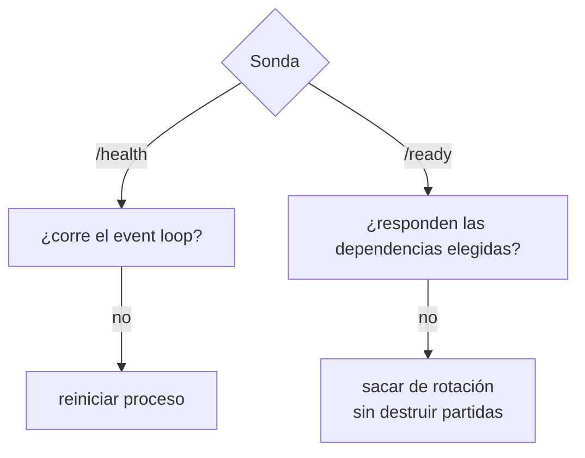
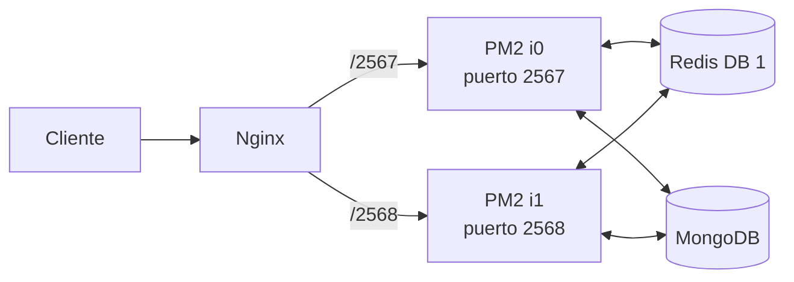
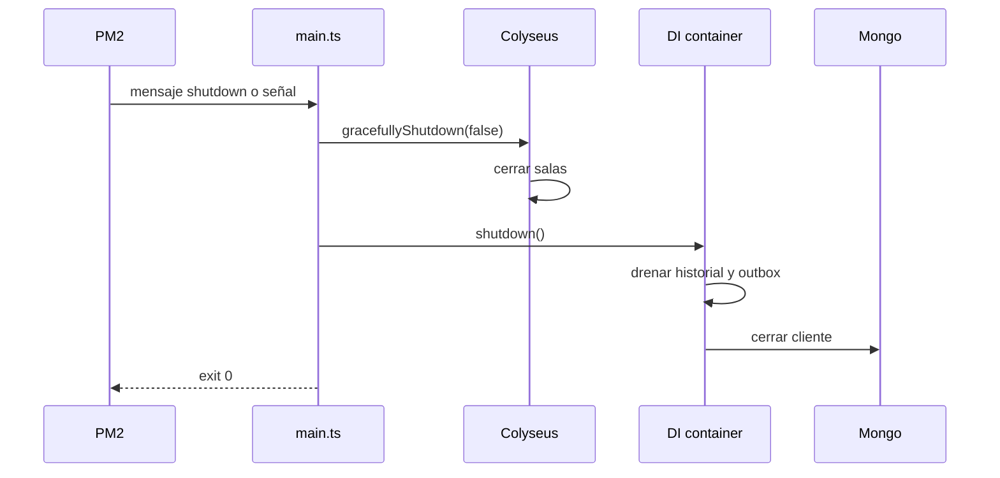

# Operación y despliegue

## Desarrollo local

```bash
cp .env.example .env
npm install
npm run dev
```

`BILLING_AUTH_PUBLIC_KEY` es obligatoria. `ADMIN_API_KEY` (la de nuestra administración, panel o soporte) habilita las rutas internas del catálogo, del historial y de la configuración en caliente. `ORCHESTRATOR_API_KEY` (la que presenta el orquestador de Betaso Juegos, mínimo 16 caracteres) habilita `POST /internal/matches`, `POST /internal/players/:userId/seat` y `GET /internal/census`, que son la única puerta de entrada a una partida; sin ella esas rutas responden 404 y nadie juega, y si está el arranque exige `ORCHESTRATOR_URL`, `ORCHESTRATOR_CALLBACK_API_KEY` y que no repita `ADMIN_API_KEY`. `BILLING_AUTH_PUBLIC_KEY` es la clave PÚBLICA EC P-256 (PEM en una línea con `\n` literales) con la que se verifican los ES256 de billing-auth, el único emisor de tokens; se valida al arrancar y una clave privada se rechaza. Esos tokens deben traer el emisor de `JWT_ISSUER` (default `betaso-games-auth`), la audiencia `JWT_AUDIENCE` (default `domino`) y el claim `game` igual a `\"domino\"`; un HS256 se rechaza. Mongo, Redis y los dos
brokers de RabbitMQ son capacidades opcionales elegidas por la presencia de sus URLs.

El mantenimiento no se opera acá: el único interruptor es el del orquestador, que deja de abrir mesas.
Las partidas ya abiertas terminan.

`npm run dev` pasa los logs por `pino-pretty` (`pino-pretty.config.cjs`); el formato del cable sigue
siendo JSON de una línea. El nivel lo decide `APP_ENV` (`debug` en local, dev y stage, `info` en
prod) salvo un `LOG_LEVEL` explícito. Cada línea lleva `instance`, `release` y el `traceId` de la
causa en curso, y nunca un `token` ni un `authorization` (salen `[oculto]`).

En local, dev y stage existen además dos secciones de `/internal/settings`, detrás de la llave del panel,
para probar a mano: `deal` fija las fichas de cada asiento (`{"hands": [[[6,6]], [[0,0]]]}`) y
`starting-score` el marcador con el que nace la próxima mesa. Se borran con `DELETE`.

Con el stack local completo:

```bash
docker compose up --build
```

## Documentación

```bash
npm run docs:dev      # servidor local con recarga
npm run docs:build    # valida y genera docs/.vitepress/dist
npm run docs:preview  # sirve el build estático
```

## Sondas



`/health` no toca bases. Una dependencia caída no se arregla reiniciando, y reiniciar destruye las
partidas que viven en ese proceso. `/ready` sí consulta cada dependencia, en paralelo y con un plazo
individual de dos segundos.

## Varias instancias

Cada proceso PM2 corre en modo `fork` y escucha en `PORT + NODE_APP_INSTANCE`; la suma la hace
Colyseus dentro de `listen()`. `env.listeningPort` es el puerto efectivo que se anuncia al cliente.



Con más de una instancia, `SERVER_ADDRESS` es obligatorio y Nginx debe rutear WebSocket y HTTP por
el prefijo del puerto anunciado. Sin `REDIS_URL`, dos procesos no forman un clúster aunque ambos
estén escuchando.

## Apagado ordenado



Redis lo cierra Colyseus en el primer paso; cerrarlo otra vez deja rechazos durante el deploy. Un
`kill -9` no ejecuta este flujo: las claves huérfanas desaparecen por TTL.

## Registro de partidas

`match_history` tiene un documento por partida (la forma v2.1, ver `docs/api-y-mensajes.md`) y cinco
índices que el proceso pide al primer uso, en segundo plano:

| Índice | Sirve a |
|---|---|
| `matchId_1` (único) | que el documento no nazca dos veces; el filtro `matchId` del listado |
| `roomId_1_createdAt_-1__id_-1` | `/game-data/:roomId` (por el prefijo); el filtro `roomId` del listado, con o sin fechas, ya ordenado |
| `createdAt_-1__id_-1` | el orden del listado: sin filtros, por fechas y con cursor |
| `seats.userId_1_createdAt_-1__id_-1` | el filtro `userId` del listado, con o sin fechas y cursor, ya ordenado. Es multikey (una clave por asiento) |
| `matchEndReason_1_createdAt_-1__id_-1` | el filtro `matchEndReason` del listado (el motivo del cierre), con o sin fechas y cursor, ya ordenado |

El filtro `id` usa el `_id_` de la colección. Cada combinación de filtros del listado sale de uno de
estos sin recorrer la colección ni ordenar en memoria, y lee como mucho `pageSize + 1` documentos en
cualquier página; lo mide `mongo-history.int.test.ts` con `explain` contra un Mongo de verdad. La
excepción es motivo + jugador juntos, que no tiene índice propio: usa uno de los dos y lee de más, hasta
las partidas de ese jugador.

**Al desplegar un índice nuevo no hay que hacer nada a mano.** El proceso pide los índices con su
primera escritura y no los espera: sobre millones de documentos uno nuevo tarda minutos, y Mongo lo
construye sin trabar la colección (desde la 4.2 sólo la bloquea un instante al empezar y otro al
terminar), así que las partidas se graban mientras tanto. En ese rato el filtro que lo usa va lento y
puede contestar 503, y el único de `matchId` todavía no protege (la cola del proceso sí). Si se
prefiere tenerlo listo antes de desplegar, se crea a mano con el mismo nombre (si coincide, el proceso
no hace nada):

```js
db.match_history.createIndex({ roomId: 1, createdAt: -1, _id: -1 }, { name: "roomId_1_createdAt_-1__id_-1" })
db.match_history.createIndex({ createdAt: -1, _id: -1 }, { name: "createdAt_-1__id_-1" })
db.match_history.createIndex({ "seats.userId": 1, createdAt: -1, _id: -1 }, { name: "seats.userId_1_createdAt_-1__id_-1" })
db.match_history.createIndex({ matchEndReason: 1, createdAt: -1, _id: -1 }, { name: "matchEndReason_1_createdAt_-1__id_-1" })
db.match_history.createIndex({ matchId: 1 }, { name: "matchId_1", unique: true })
```

El `roomId_1` que creaba la versión anterior quedó cubierto por el compuesto (su prefijo): no estorba,
pero ocupa memoria y frena cada escritura. Una vez creado el compuesto, se puede borrar:
`db.match_history.dropIndex("roomId_1")`.

**El de `seats.userId` es el más grande de los cinco**: lleva una clave por asiento (dos o cuatro por
partida; un usuario en dos asientos de la misma partida es una sola), así que es el que más tarda en
construirse. Mientras no exista, el filtro por jugador funciona pero recorre el índice de fechas descartando partidas (o, para un
jugador con pocas, las ordena en memoria), y una búsqueda ancha puede terminar en el 503 del plazo. Tiene
que ser el compuesto: con `{ "seats.userId": 1 }` solo, el plan medido ordena en memoria (`SORT`).

**Para ver el plan de un listado**, la consulta es la que arma `pageQueryOf` (`mongo-history.ts`): los
filtros, `sort: { createdAt: -1, _id: -1 }` (salvo con `matchId` o `id`, que son únicos) y
`limit: pageSize + 1`. Por ejemplo, una sala en un rango de fechas:

```js
db.match_history.find(
  { roomId: "ZYIVoz6TQ", createdAt: { $gte: ISODate("2026-10-01T00:00:00Z"), $lt: ISODate("2026-10-02T00:00:00Z") } },
  { matchId: 1, roomId: 1, status: 1, createdAt: 1 },
).sort({ createdAt: -1, _id: -1 }).limit(21).explain("executionStats")
```

En `queryPlanner.winningPlan` tiene que haber un `IXSCAN` (o `IDHACK` para `id`) y **ni `COLLSCAN` ni
`SORT`**; en `executionStats`, `totalDocsExamined` no pasa de `limit`. Una página con cursor tiene el
`$or` en la raíz y su plan es `SUBPLAN` → `SORT_MERGE` sobre dos `IXSCAN` del mismo índice: el
`SORT_MERGE` une dos ramas ya ordenadas y no bloquea. El filtro por jugador es
`{ "seats.userId": "<userId>" }` y su plan es un `IXSCAN` de `seats.userId_1_createdAt_-1__id_-1`, también
sin `SORT` aunque el índice sea multikey. Si aparece un `COLLSCAN` o un `SORT`, falta un índice
(`db.match_history.getIndexes()`).

Cada consulta del listado lleva `maxTimeMS: 5000`. Una que lo excede contesta 503 al panel y deja un
`warn` `«listado de partidas: la base excedió el plazo»`: con los índices en su lugar no debería pasar,
así que es la señal de un índice que falta o de una base saturada.

Si el único no se puede crear —dos documentos viejos de la misma partida— el proceso graba igual y lo
dice con un `error`: `«historial: no se pudieron crear los índices; se graba igual»` (el campo `indexes`
dice cuáles). Los dos del listado se crean igual: van en otro pedido, porque `createIndexes` es todo o
nada. Para encontrar los repetidos y dejar uno:

```js
db.match_history.aggregate([
  { $group: { _id: "$matchId", n: { $sum: 1 }, ids: { $push: "$_id" } } },
  { $match: { n: { $gt: 1 } } },
])
```

El índice se vuelve a pedir en el próximo arranque.

Para rebobinar una partida alcanza con su id: `npm run replay -- <matchId>` lee la cabecera del
documento (seed, parejas, plazos, marcador inicial). Los documentos de antes de la v2.1 no la tienen y
siguen pidiendo los argumentos: `npm run replay -- <matchId> <seed> <pointsToWin> <SHUFFLED|SEAT_ORDER>
<asiento...>`.

### Por qué se desconectó alguien

Cada jugador del registro cerrado lleva `connection`: el ping que midió el servidor (`rtt`: promedio,
peor, fluctuación y sondeos perdidos) y la lista de hechos (`events`): `DROPPED` (se cayó), `RECONNECTED`
(volvió, con `awayMs`) y `GONE` (no volvió). Cada caída trae `verdict.blame`:

| `blame` | qué fue | `cause` |
|---|---|---|
| `OURS` | el servidor | `SERVER_SHUTDOWN` (apagado o deploy), `SERVER_OVERLOAD` (el proceso trabado, o el ping alto a la vez para la mayoría de los conectados al proceso, con al menos 3), `SERVER_ERROR` |
| `NETWORK` | la conexión del jugador | `POOR_CONNECTION` (el ping venía alto o inestable), `CONNECTION_LOST` (se cortó de golpe), `WENT_OFFLINE` (el navegador avisó que perdió la red) |
| `INTENTIONAL` | el jugador | `LEFT_THE_TABLE` (salió con el botón), `CLOSED_APP` (cerró o recargó; si hay un `RECONNECTED` justo después, recargó) |
| `UNKNOWN` | un código de cierre que la regla no conoce | `UNKNOWN_CLOSE` |

La evidencia viaja al lado (`closeCode`, `recentRttMs`, `sinceLastPongMs`, `server`), así que se puede
discutir el veredicto con los mismos números. Un `GONE` con `afterDrop` vale lo que dijo su `DROPPED`.
Minimizar la app en el celular hoy sale como `NETWORK`. Cada hecho sale además en el log como
`conexión`, con `playerId`, `blame` y `cause`.

## Resultados de partida

Cada resultado se escribe primero en Mongo (`match_result_outbox`) y después se publica al exchange
`betaso_games` con confirmación del broker. La entrada queda `SENT` y **se borra sola a los 7 días**
(índice TTL sobre `sentAt`). Una entrada que no sale no vence nunca: se reintenta sin límite, con espera
creciente hasta 5 minutos.

- **Un resultado trabado** deja un `warn` por cada fallo, y pasados **10 minutos** sin salir cada fallo
  es un `error` con `«el resultado de partida lleva demasiado sin salir»`. Es la línea que conviene
  alertar: detrás hay un premio que no se pagó.
- **Si el broker pierde su disco**, se pierde lo que estaba en las colas sin consumir, pero dominó
  conserva cada resultado de los últimos 7 días. Para reenviarlos, se vuelven a `PENDING` los enviados
  desde un poco antes del incidente; el despachador los publica solo:

  ```js
  db.match_result_outbox.updateMany(
    { status: "SENT", sentAt: { $gte: ISODate("<instante anterior al incidente>") } },
    { $set: { status: "PENDING", attempts: 0, nextAttemptAt: new Date() }, $unset: { sentAt: "" } },
  )
  ```

  Repetirlos es seguro: el orquestador encuentra las órdenes de un premio por su clave y no paga dos
  veces, y cada cliente descarta un reporte repetido por `Idempotency-Key`.

## Verificación

```bash
npm run typecheck
npm run lint
npm test
npm run build
npm run docs:build
npm run depcruise
```

El smoke real agrega Docker, dos procesos PM2, Nginx, Redis, Mongo y RabbitMQ:

```powershell
$env:RUN_ENGINE_SMOKE='1'; npm run test:deploy; Remove-Item Env:RUN_ENGINE_SMOKE
```

## Despliegue y rollback

Es el mismo estilo que billing-auth y el orquestador en games-orchestrator, portado y acoplado al
dominó: `.github/workflows/ci-cd.yml` y `scripts/deploy/`.

| Rama | Entorno |
| --- | --- |
| `develop` | dev |
| `stage` | stage |
| `main` | prod |

Un PR o un push a otra rama solo verifica. `workflow_dispatch` despliega desde **cualquier** rama al
entorno que se elija: así se prueba una feature en dev sin mergearla.

El workflow tiene estos jobs:

- **`target`:** elige el entorno y el medio.
- **`verify`:** typecheck, lint, tests (incluidos los de `scripts/deploy`), build y empaquetado.
- **`smoke`:** la certificación con Docker, PM2 y Nginx.
- **`image`:** la imagen `runtime`, construida siempre.
- **`docs`:** el sitio de docs.
- **`deploy`:** espera a todos los anteriores. Sube el release, corre en el servidor el script que viaja
  adentro y comprueba `PUBLIC_URL/health` **desde el servidor** (Cloudflare le contesta 403 a los runners
  de GitHub).

### En el servidor

```
/var/www/Betaso/domino-backend-v2/
├── shared/.env          el entorno real; se crea una vez a mano y el despliegue nunca lo toca
├── shared/deploy.env    cómo se desplegó la última vez (lo escribe el despliegue)
├── releases/<id>/       el artefacto; se conservan el que corre y el anterior
├── current ──► releases/<id>
├── logs                 ./logs, ./logs --lines 200 --nostream
├── restart              recrea el proceso sin cambiar de versión
└── rollback             vuelve al release anterior, sin argumentos
```

`/ready` se consulta instancia por instancia, y el despliegue mira qué release corre de verdad
(`/proc/<pid>/cwd` con pm2, o la imagen del contenedor con Docker). Si el release nuevo no queda sano,
vuelve solo al anterior, marca el nuevo con `FAILED` y el pipeline queda en rojo. Los releases marcados
`FAILED` no son candidatos al rollback. **El rollback vuelve el código**: lo que ya se escribió en Mongo,
Redis o RabbitMQ se queda.

### Medios

`DEPLOY_MODE` (variable del repositorio, o el input `mode` del dispatch) elige el medio:

- **`pm2`** (por defecto): el bundle y `npm ci --omit=dev`, con las dependencias reusadas si el lockfile
  y el node no cambiaron.
- **`docker`:** la imagen la construye el CI y viaja por scp.
- **`docker-build`:** la imagen la construye el servidor.

Con Docker corre el servicio `domino-server` de `compose.yaml` (perfil `server`), en **una sola
instancia**: Mongo, Redis y RabbitMQ son los del servidor, con `host.docker.internal` en el `.env`.

Para **cambiar de medio**, se baja a mano el que corre y después se despliega con el otro. Los scripts se
niegan a arrancar mientras el otro medio esté sirviendo, porque usan el mismo puerto:

- de pm2 a Docker: `pm2 delete <APP_NAME>`;
- de Docker a pm2: `docker compose -p <APP_NAME> down`.

### Configuración en GitHub

**Del repositorio:** `DEPLOY_ENVIRONMENTS` (hoy `dev`) y `DEPLOY_MODE`.

**Del Environment de cada entorno** (`dev`, `stage`, `prod`):

| Nombre | Tipo | Qué es |
| --- | --- | --- |
| `SSH_HOST`, `SSH_USER`, `SSH_KEY` | secreto | El acceso por ssh |
| `SSH_KNOWN_HOSTS` | variable | La clave del host, fijada |
| `DEPLOY_PATH` | variable | `/var/www/Betaso/domino-backend-v2` |
| `APP_NAME` | variable | `domino-backend-v2-dev` |
| `INSTANCES` | variable | Cuántas instancias |
| `NODE_BIN`, `NODE_INTERPRETER` | variable | El node 22 de nvm: el pm2 del VPS corre con el 20 del sistema |
| `PUBLIC_URL` | variable | `https://backend-dev-domino-game-v2.elbetaso.com` |

### Preparar un servidor la primera vez

1. Crear `DEPLOY_PATH/shared/.env` a partir de `.env.example`. En dev:
   - `PORT=2571` y `APP_ENV=dev`;
   - las llaves (`ORCHESTRATOR_API_KEY`, la misma que `DOMINO_API_KEY` del orquestador) y
     `BILLING_AUTH_PUBLIC_KEY`;
   - `MONGO_URI` (el Mongo del VPS escucha en `:27018`);
   - `REDIS_URL`, con un índice propio;
   - `RABBITMQ_URL`;
   - para las mesas del orquestador, `ORCHESTRATOR_URL` (la base del orquestador),
     `ORCHESTRATOR_CALLBACK_API_KEY` (= `DOMINO_CALLBACK_API_KEY` del orquestador) y
     `BETASO_GAMES_RABBITMQ_URL` (el vhost `betaso_games`, donde salen los resultados).
2. Crear el vhost del dominio hacia `127.0.0.1:PORT`, con el `RewriteRule … ws://` del upgrade de
   WebSocket.
3. Cargar en GitHub las variables y los secretos de arriba, y sumar el entorno a `DEPLOY_ENVIRONMENTS`.

En dev, el dominó **v1** (`domino-backend-dev`, `:2567`, `backend-dev-domino-game.elbetaso.com`) sigue
corriendo en `/opt/domino-backend/development`. Este no lo toca.
